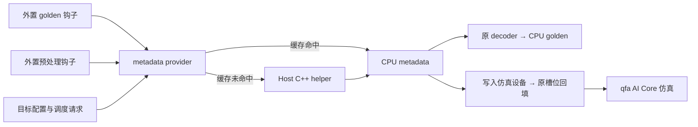

# QFA 仿真环境的 Mock AICPU 设计与 Agent 交接

日期：2026-10-29  
状态：Host 与外置接入实现、原 CPU Python 链路及 TTK discovery 已完成；41 项测试通过。真实设备验收未完成，最新进度见第 20 节。  
仓库：`/Users/fanghaolei/Workplace/agent/ops-transformer`  
原型：`scratch/qfa-metadata-mock/`  
当前实现：`/Users/fanghaolei/Workplace/agent/aicore_mock`（远端 `git@github.com:Faione/aicpu_mock.git`）

## 1. 目标与结论

NPU 仿真环境能够执行 AI Core 内核，不能执行 AICPU。当前 QFA assets 在 golden 计划获取和设备预处理两处依赖 qfa_metadata，因此需要在 Host CPU 上计算兼容的 metadata，供原 golden 和真实 qfa AI Core 内核使用。

推荐新增 **外置 QFA Mock Spec、两个薄适配钩子及共享 metadata provider**，通过 TTK 的 `--plugin` 选择 mock 工作流。原 assets、TTK 和生产算子源码保持原样，继续复用原输入生成、golden 数值计算、metadata 槽回填及精度比较。metadata 计算由已准备好的 CPU mock 或 Host C++ helper 提供。

零源码修改的具体接入方案见[第 17 节](#17-外置-spec-零源码修改接入方案)。原方案中直接修改两个 assets 入口、增加显式分支的方式保留为可选集成方案，不是本轮接入的前置条件。

本方案只覆盖当前 QFA 场景，不建设通用 AICPU 仿真框架。

## 2. 已确定的需求与约束

| 项目 | 约定 |
|---|---|
| 实现范围 | 第一阶段采用 MXFP8、`quant_mode=1`、正向、Eager；以现有用例为基线扩展参数化 |
| 目标平台 | 目标信息已知，由用户配置提供；已有目标名称为 mk001，设计核数为 AIC=80、AIV=80 |
| 原代码改动 | 主方案不修改原 assets、TTK、Torch 算子注册、生产算子 Host 或 AI Core；新增外置插件及适配模块 |
| 数值参考 | golden 的 Attention 与 LSE 仍由 Host CPU 计算，使用与 qfa 一致的调度计划 |
| 正式执行 | qfa 仍走真实 Torch、ACLNN、Runtime 与 AI Core 仿真路径 |
| 输出要求 | 输出与现有 metadata 协议兼容，不能只有相同 shape |
| 原设计阶段交付 | 当时仅交付设计文档；当前独立原型实现及验收进度见第 18 节 |

mk001 的名称与 80/80 本身不能决定分块模板。实际实施时，使用用户确认的 SoC 标识、qfa 编译架构和有效核数；本文不将 mk001 自动映射为 arch92。

## 3. 当前链路与两个接入点

现有标准链路中：

1. TTK 生成 CPU 输入。
2. golden 请求 qfa_metadata，在 AICPU 生成计划，读回主机并解码，再在 CPU 计算参考 Out、LSE。
3. 输入写入设备后，`npu_preprocess` 再次请求 qfa_metadata，生成主算子所需的设备 metadata。
4. qfa 的 AI Core 内核读取 metadata，生成真实 Out、LSE。
5. Host CPU 比较真实输出与 golden。

两个行为替换点必须同时覆盖。主方案由外置钩子完成替换，不编辑下表中的原文件。

| 文件与入口 | 当前职责 | 外置适配方式 |
|---|---|---|
| `attention/quant_flash_attn/tests/assets/quant_flash_attn_golden.py`：`get_qfa_section_info` | 查询分段缓存，必要时调用设备 metadata，再解码 | 在外置 golden 调用期间替换整个计划获取函数，直接解码 provider 的 CPU metadata，绕过原缓存、`_HAS_NPU` 和异常回退 |
| `attention/quant_flash_attn/tests/assets/impl/npu_preprocess.py`：`run_metadata` | 调用真实 qfa_metadata，返回设备 Tensor | 在外置预处理调用期间替换该函数，从 provider 取得 CPU metadata，写入目标设备并返回设备 Tensor |

使用原 assets 路径启动时继续走现有逻辑；使用外置 Spec 文件启动时覆盖 golden 与预处理钩子。原 `spec.py` 不变，外置 Spec 通过继承复用输入、compare 和容差。

“两处入口”描述需要接管的行为，不代表必须改写两个源文件。请求所需字段从外置钩子实际收到的参数中整理；必要时在外置适配模块补充，不在原文件中添加分支。

## 4. 原型的复用方式

| 原型文件 | 已有价值 | 后续设计要求 |
|---|---|---|
| `generate.cpp` | 复用原分块函数、`SectionStreamK::Compute` 和 metadata 格式 | 去掉固定的 batch、长度、head 数、D 和平台参数，改为请求驱动 |
| `arch92_80_80.bin` | 一个固定用例的候选计划 | 保留为回归样本；不要作为全部用例的运行时返回值 |
| `mock_spec.py` | 证明外置 Spec 可继承原类并局部替换两个函数 | 作为正式接入适配层的基础，替换固定样例计划，补齐参数、生命周期和配置处理 |
| `validate.py` | 使用原 decoder 校验任务覆盖 | 参数化校验输入，补充 FD、容量和初始化标志校验 |

原型中的 CPU 编译和覆盖校验不等于新的参数化方案已验收。后续需要重新完成本文件定义的验证。

## 5. 推荐结构

建议新增以下逻辑组件，实际文件可合并：

| 组件 | 责任 |
|---|---|
| 配置读取 | 生成不可变的目标配置，明确 native 或 mock 模式 |
| 请求整理 | 将两个入口转换为统一的调度请求 |
| metadata provider | 模式分派、缓存、输出校验和结果交付 |
| Host C++ helper | 在 CPU 计算分核计划并序列化 metadata |
| 校验工具 | 格式、覆盖、真实 AICPU 对拍及仿真链路验证 |

provider 和适配器放在外置插件目录，原 assets 中不新增文件。两个入口通过稳定模块名取得同一个 worker 内的 provider 实例，避免懒加载产生两套缓存。注册阶段不初始化 NPU，配置、mock 引擎和原实现模块在 worker 中按需使用。



主方案使用外置 Spec 与有明确作用域的模块函数替换，不替换全局 `torch.ops`，不复制整套 golden 或预处理实现。两个计划接管点分别为 `get_qfa_section_info` 和 `run_metadata`；另允许在 golden 调用期间对 `_cpu_mxfp8_golden_sectioned` 增加异常保护，阻止原实现失败后回退。三处均串行保护，退出时恢复，具体约束见第 17.8 节。

## 6. 配置设计

使用 `--plugin` 选择原生或 mock 工作流；外置 mock 插件通过环境变量 `QFA_METADATA_CONFIG` 读取目标配置，不增加 TTK 参数，也不在每条 CSV 用例重复配置平台。

首版沿用已实现的 JSON 配置与进程内缓存；YAML 和持久化缓存不列为接入前置条件。以下目标字段仍须按部署环境确认：

```json
{
  "backend": "mock_aicpu",
  "target": {
    "name": "mk001",
    "soc_version": "<用户确认的元算子 SoC 标识>",
    "kernel_arch": "<用户确认的 qfa 编译架构>",
    "aic_core_num": 80,
    "aiv_core_num": 80
  },
  "cache": {"enabled": true, "max_entries": 8}
}
```

配置语义：

- `--plugin` 指向原 assets 时走 native，原代码不需要识别新配置。
- `--plugin` 指向外置 Spec 时走 mock，必须提供有效配置且 `backend=mock_aicpu`；配置缺失或错误时失败，不自动调用真实 AICPU。
- 模式不依据 `torch.npu.is_available()` 自动选择。
- SoC 标识用于选择与原 metadata 一致的调度策略；编译架构用于检查与 qfa 模板的兼容性。
- AIC、AIV 是本次执行的有效 Cube、Vector 核数，不是 AICPU 核数。
- M、S2、FD、各核任务区间由算法推导，不要求用户填写。
- 算法内部的 L2 分段与 FD 参数按当前源码策略确定，不直接拿用户填写的硬件容量替换代码中的策略常量。

配置仅为 mock 提供计算输入，不会改变 qfa 的 CANN 平台配置。进入主算子执行前，应检查目标架构、有效核数和分块规则与实际 qfa tiling 一致。CPU helper 自身不依赖设备属性查询；设备接入可使用可信的运行时查询，或绑定本次仿真与 qfa 构建的离线平台记录完成检查。查询不可用不直接判定配置错误；两种证据均缺失则停止设备执行。核对规则见第 19 节评审文档。

## 7. 统一调度请求

两个入口必须生成同一种请求。请求的数据来源是当前用例及实际调用参数，不能只用用例名称或原型的固定常量。

| 类别 | 字段 |
|---|---|
| 平台 | 目标 SoC 标识、编译架构、有效 AIC 与 AIV 核数 |
| 形状 | batch、`num_heads_q`、`num_heads_kv`、`head_dim`、`head_dim_v` |
| 长度 | 原始 `cu_seqlens_q`、`cu_seqlens_kv`、`seqused_q`、`seqused_kv`，以及最大长度属性 |
| 属性 | `quant_mode`、`mask_mode`、`win_left`、`win_right`、Q 与 KV 及 scale 和输出布局、`is_grad_enabled` |

整理规则：

1. 按真实 metadata 接口处理默认值、空 Tensor、batch 推导和有效长度优先级。
2. 保留原始累积长度和有效长度。即使最终有效长度相同，分配长度不同也可能改变 `needInitOutput`。
3. golden 与预处理使用相同的默认值规则。不能一处保留 `max_seqlen=-1`，另一处自行改成实际长度。
4. 原 `build_metadata_arguments` 目前未完整传递窗口等字段。非默认值必须从实际调用补齐；无法可靠取得时拒绝该组合，不能静默猜测。
5. golden 适配器从本次钩子实参整理请求，不从旧全局状态推导全部字段；原 decoder 则使用原 CPU golden 为本次调用设置的上下文。
6. 请求不包含 Q、K、V 的数值。预处理入口只有设备 Tensor 时，最多将小型长度 Tensor 读回主机；不要将 Q、K、V 全量读回。

首版从原型的 TND、PA_BNBD、mask=3、默认窗口、D=128 基础用例起步，以测试集合逐项扩大参数范围。不能因核心调度函数接受某个参数，就直接宣称现有 golden 和 kernel 的完整组合均已支持。

## 8. Host C++ helper 的计算过程

继续使用纯 Host C++ helper，测试前编译完成。首版建议沿用独立可执行程序形式，由 provider 传入请求并接收结果，不在用例执行过程中编译，不引入 Torch C++ 扩展构建流程。

helper 不能直接编译调用依赖 `CpuKernelContext` 的 AICPU 入口。应复用纯算法头文件，并对包装层的参数整理、初始化判断和序列化实现 Host 等价适配。

| 阶段 | 必须完成的内容 | 对应源码 |
|---|---|---|
| 参数整理 | 默认值、batch、实际长度、布局和数据类型处理 | `Prepare`、`ParamsInit` |
| 分块选择 | 根据平台、head dimension、prefill 或 decode 选择 M 与 S2 | `AdjustSinnerAndSouter`、`AdjustSinnerAndSouterArch92` |
| 策略设置 | FD、L2 分段、负载均衡参数和 kernel split mode | `ParamsInit` |
| 任务分配 | 调用原负载均衡算法 | `SectionStreamK::Compute` |
| 输出初始化 | 识别零长度、padding、全 mask 行等情况 | `CheckNeedInitOutput` |
| 输出编码 | Header、FA、FD 与容量检查 | `GenMetaData`、`SetMetadataHead/Fa/Fd` |

等价性以当前源码为准。不要在移植时顺手调整分块或负载均衡策略，否则 CPU golden 与真实 kernel 可能采用不同的数值分段。

原型中固定的 `needInitOutput=0` 只适用于原样例，参数化后必须按输入计算。FD 区也不能统一填零，应依据当前平台与调度结果编码。

### helper 的交付约定

- 输入：目标配置与统一调度请求，建议使用结构化 JSON。
- 输出：metadata 二进制及摘要，至少记录 shape、有效长度、平台、请求摘要和算法版本。
- 二进制：明确使用 little-endian int32 表示；内部字段仍按原协议的 uint32 位模式处理。
- 失败：返回清楚的错误原因，provider 将当前用例判为失败。
- 并发：每个 worker 使用独立工作目录或唯一请求目录，不覆盖其他请求的文件。

## 9. metadata 输出协议

provider 统一向调用方提供 CPU 上的连续 `int32` Tensor，形状为 `(2, rowSize)`。

| 区域 | 结构与用途 |
|---|---|
| 第一行 Header | 16 个 word |
| 第一行 FA | `sectionNum × aicNum × 16` 个 word |
| 第一行 FD | `sectionNum × aivNum × 16` 个 word |
| 第二行 | 当前正向范围内清零；不生成反向调度 |

Header 的有效槽位：

| 索引 | 含义 |
|---|---|
| 0 | sectionNum |
| 1 | isFD |
| 2 | M 基本块大小 |
| 3 | S2 基本块大小 |
| 4 | AIC 数量 |
| 5 | AIV 数量 |
| 15 | needInitOutput |

FA 记录包括 `(bn,m,s2)` 的起止区间及 FD workspace 索引；FD 记录包括归约任务位置、workspace、切分份数与行区间。每条记录占 16 个 word，预留字段清零。

容量参考当前 Torch 分配规则：

```text
rowSize = 按 4096 个元素向上对齐(
    16 + (aicNum + aivNum) × 16 × batch × numHeadsQ
)
```

4096 的单位是元素，不是字节；核数取用户目标配置，batch 按统一规则推导。编码后必须额外检查：

```text
16 + sectionNum × (aicNum + aivNum) × 16 <= rowSize
```

不能调用当前依赖 `_get_core_nums()` 的原分配路径后，再修改 Header 核数。核数同时影响容量、FA/FD 偏移、任务分配和分块规则。

## 10. 两个消费路径

### golden

1. 外置 golden 钩子绑定本次实际参数，整理调度请求。
2. 在原 CPU golden 调用期间，将其使用的 `get_qfa_section_info` 替换为 mock 回调。
3. 回调从 provider 取得 CPU metadata，使用原 `_decode_qfa_sections` 解码。
4. 原 CPU golden 按分段计算 Out、LSE；异常保护阻止其内部全局回退，退出作用域后恢复计划入口与保护函数。

整个原计划获取函数被替换，因此原缓存、`_HAS_NPU`、设备计划获取和失败回退均不会参与 mock 路径。

mock 计算失败时直接报错，不进入原来的“设备 metadata 失败后改用全局参考计算”分支。否则测试可能使用不同的量化分段而继续运行。

### npu_preprocess

1. 外置预处理钩子绑定实际参数并整理请求。
2. 在原 `run` 调用期间，将原模块的 `run_metadata` 替换为 mock 回调。
3. 回调从 provider 取得 CPU metadata，将内容写入目标仿真设备，返回与设备锚点同设备的 Tensor。
4. 原 `run` 继续处理动态槽返回、`(0,)` 占位调整、静态槽形状检查和 `copy_` 回填。
5. 外置钩子原样返回原 `run` 的结果，并恢复被替换函数；TTK 再调用原 qfa。

只修改预处理一处不能消除 golden 的 AICPU 依赖；只替换 golden 也不能阻止预处理提交真实 metadata 任务。

## 11. 缓存与一致性

缓存以 CPU metadata 为主副本，按 worker 隔离，结果不可被 decoder 或设备回填修改。golden 与预处理共享相同内容，但不要求共享同一个可变 Tensor 对象。

缓存键至少包含：

- 目标 SoC、架构、有效核数与其他影响调度的目标参数。
- 全部已支持的调度属性与维度。
- 原始长度数组的实际值，不能只使用 shape 或最大值。
- 算法版本、metadata 格式版本。

缓存未命中时计算，命中时复用。关闭 golden 后，预处理仍应能够独立生成计划。目标或长度变化时必须失效。

两个请求字段不同，不能仅因用例名称相同而强行返回同一缓存条目。发现 golden 与预处理本应一致的请求出现差异时，应报告具体字段，而不是掩盖差异。

## 12. 错误处理与诊断

| 情况 | 处理 |
|---|---|
| 配置缺失 | 原 assets 路径继续 native；外置 mock 插件缺少有效配置时失败 |
| 架构、核数与 qfa tiling 不一致 | 在主算子执行前失败，列出双方配置 |
| 属性或布局尚未支持 | 明确拒绝，不读取固定样例计划代替 |
| 请求缺字段或默认值不一致 | 报告字段及来源 |
| helper 失败、输出容量不足或格式错误 | 当前用例失败，不回退真实 AICPU |
| 任务覆盖或 decoder 校验失败 | 当前用例失败，不回退全局参考计算 |

每次计划生成或缓存命中至少记录：模式、目标摘要、请求摘要、算法版本、Header、活跃核数、section 数、有效调度区长度。按需保留完整请求和 metadata，便于重现。

## 13. 验证与验收

### A. CPU 结构校验

- Header 与目标配置一致。
- 容量及 FA、FD 偏移正确。
- 任务区间合法，完整覆盖应计算区域，没有重复。
- 未使用记录与预留字段清零。
- 初始化标志和 FD 信息与算法结果一致。
- 原 decoder 能使用实际用例参数解码。

### B. 真实 AICPU 对拍

在可执行 AICPU 的设备上，使用该设备真实的 SoC、核数和相同请求，分别生成真实结果与 CPU helper 结果。

比较有效 Header、FA、FD 及分段语义，不要求未使用或未初始化区域逐字节相同。其他设备只能验证其可支持的配置；不能把较少核数设备的输出改成 80/80，充当目标平台的对拍结果。

### C. 仿真链路

- golden 与预处理均未提交真实 qfa_metadata 任务。
- 两个入口在相同请求下使用相同的计划摘要。
- golden 数值计算完整在 Host CPU 运行。
- qfa 仍由原 AI Core 内核执行，metadata 写入设备后正确回填。
- 开启与关闭 golden 均能完成计划准备。
- Out、LSE 分别通过用例容差比较。

### D. 模式隔离

未开启 mock 时，原 native 流程保持现有行为。缓存不能跨目标配置或算法版本复用。

## 14. 建议实施顺序

1. 确定首批支持的目标配置和用例集合。
2. 定义目标配置、调度请求、结果摘要与错误约定。
3. 参数化原型 C++ helper，补齐初始化判断、序列化及容量校验。
4. 实现 provider 与进程内缓存。
5. 新增外置 Spec 与两个薄钩子，核对参数来源、懒加载、替换恢复和串行保护。
6. 完成 CPU 校验、原 hook 和真实 CPU golden 接入；真实 AICPU 对拍与目标平台准备可并行推进。
7. 完成目标仿真的 qfa Out、LSE 比较，单独记录真实对拍是否完成。

后续 agent 应先核对本地源码与本设计是否仍一致，再根据用户后续指令评审或实施。仓库存在 `.codegraph/` 时，遵循用户要求，先使用 CodeGraph 定位和理解代码。

## 15. 源码导航

以下链接使用当前工作区绝对路径。仓库迁移后，以同名相对路径定位。

| 内容 | 位置 |
|---|---|
| 原型说明 | [scratch/qfa-metadata-mock/README.md](/Users/fanghaolei/Workplace/agent/ops-transformer/scratch/qfa-metadata-mock/README.md) |
| 原型 CPU helper | [generate.cpp](/Users/fanghaolei/Workplace/agent/ops-transformer/scratch/qfa-metadata-mock/generate.cpp) |
| 原型替换方式 | [mock_spec.py](/Users/fanghaolei/Workplace/agent/ops-transformer/scratch/qfa-metadata-mock/mock_spec.py) |
| 原型 decoder 校验 | [validate.py](/Users/fanghaolei/Workplace/agent/ops-transformer/scratch/qfa-metadata-mock/validate.py) |
| golden 计划入口 | [get_qfa_section_info](/Users/fanghaolei/Workplace/agent/ops-transformer/attention/quant_flash_attn/tests/assets/quant_flash_attn_golden.py:875) |
| 原设备计划获取 | [_build_qfa_section_info](/Users/fanghaolei/Workplace/agent/ops-transformer/attention/quant_flash_attn/tests/assets/quant_flash_attn_golden.py:910) |
| 分段 decoder | [_decode_qfa_sections](/Users/fanghaolei/Workplace/agent/ops-transformer/attention/quant_flash_attn/tests/assets/quant_flash_attn_golden.py:994) |
| 预处理参数整理 | [build_metadata_arguments](/Users/fanghaolei/Workplace/agent/ops-transformer/attention/quant_flash_attn/tests/assets/impl/npu_preprocess.py:113) |
| 预处理 metadata 调用 | [run_metadata](/Users/fanghaolei/Workplace/agent/ops-transformer/attention/quant_flash_attn/tests/assets/impl/npu_preprocess.py:208) |
| 原槽位回填 | [run](/Users/fanghaolei/Workplace/agent/ops-transformer/attention/quant_flash_attn/tests/assets/impl/npu_preprocess.py:238) |
| AICPU 计算入口 | [Compute](/Users/fanghaolei/Workplace/agent/ops-transformer/attention/quant_flash_attn_metadata/op_kernel_aicpu/quant_flash_attn_metadata_aicpu.cpp:29) |
| 参数与策略 | [ParamsInit](/Users/fanghaolei/Workplace/agent/ops-transformer/attention/quant_flash_attn_metadata/op_kernel_aicpu/quant_flash_attn_metadata_aicpu.cpp:151) |
| 输出初始化判断 | [CheckNeedInitOutput](/Users/fanghaolei/Workplace/agent/ops-transformer/attention/quant_flash_attn_metadata/op_kernel_aicpu/quant_flash_attn_metadata_aicpu.cpp:948) |
| metadata 编码 | [GenMetaData](/Users/fanghaolei/Workplace/agent/ops-transformer/attention/quant_flash_attn_metadata/op_kernel_aicpu/quant_flash_attn_metadata_aicpu.cpp:1021) |
| metadata 协议 | [quant_flash_attn_metadata.h](/Users/fanghaolei/Workplace/agent/ops-transformer/attention/quant_flash_attn_metadata/op_kernel_aicpu/quant_flash_attn_metadata.h:24) |
| 纯 CPU 调度函数 | [SectionStreamK::Compute](/Users/fanghaolei/Workplace/agent/ops-transformer/attention/common/op_kernel/load_balance/section_stream_k/section_stream_k.h:32) |
| 分块函数 | [qfa_adjust_sinner_souter.h](/Users/fanghaolei/Workplace/agent/ops-transformer/attention/quant_flash_attn/op_host/qfa_adjust_sinner_souter.h:49) |
| 当前 metadata 容量计算 | [_calculate_max_schedule_size](/Users/fanghaolei/Workplace/agent/ops-transformer/attention/quant_flash_attn/torch_extension/quant_flash_attn.py:86) |
| Host 查询有效核数 | [aclnn_quant_flash_attn_metadata.cpp](/Users/fanghaolei/Workplace/agent/ops-transformer/attention/quant_flash_attn_metadata/op_host/op_api/aclnn_quant_flash_attn_metadata.cpp:60) |
| 原 Spec 与懒加载器 | [spec.py](/Users/fanghaolei/Workplace/agent/ops-transformer/attention/quant_flash_attn/tests/assets/spec.py:29) |
| TTK 的插件文件发现 | [SpecLoader](/Users/fanghaolei/Workplace/agent/ops-test-kit/ttk/core_modules/common/plugin/spec_loader.py:148) |
| TTK 的继承属性读取 | [get_spec_attr](/Users/fanghaolei/Workplace/agent/ops-test-kit/ttk/core_modules/common/plugin/spec_manager.py:64) |
| CPU、AICPU、AI Core 分工依据 | [qfa_ttk_multi_round_analysis.md](/Users/fanghaolei/Workplace/agent/ops-transformer/scratch/qfa_ttk_multi_round_analysis.md) |

## 16. 交接完成检查

- [ ] 目标 SoC、编译架构与有效核数已明确。
- [x] 首批支持的用例属性与布局已列出。 已在独立仓库 README / CONTRACT 列出；仅首版支持范围。
- [x] 两个入口的请求字段来源与默认值已对齐。 已支持组合的适配一致性通过 CPU 测试；未宣称全部原生组合支持。
- [x] provider 不依赖设备查询才能生成 mock 计划。 Host CLI 已在无 Torch/CANN 环境运行。
- [x] Host helper 覆盖分块、调度、初始化判断和完整 metadata 编码。 首版 D=128、MXFP8 正向范围，Header / FA / FD 已验证。
- [ ] golden 直接消费 CPU metadata，预处理将相同内容写入设备。 CPU 控制流与替身已验证；真实 H2D 未验收。
- [x] 缓存键包含目标、实际长度数组、属性和算法版本。 另含源码指纹，保留原始分配长度。
- [x] mock 错误不会触发真实 AICPU 或全局参考回退。 原函数 CPU 链路、真实 TTK SpecLoader 与恢复/失败检测已验证；设备验收另见第 20 节。
- [ ] CPU 结构校验、真实对拍、仿真 Out 与 LSE 验证均有记录。 18 项 CPU 测试通过；真实 AICPU 对拍及仿真精度未运行。
- [ ] 原 assets 与 TTK 无源码改动；native 模式保持现有行为。 本轮测试前后 21 个相关上游文件摘要不变；native 单独启动未验收。
- [x] 外置 Spec 覆盖两个钩子，局部替换在成功和异常路径均恢复。 原函数 CPU 链路、真实 TTK SpecLoader 与恢复/失败检测已验证；设备验收另见第 20 节。
- [x] 外置插件实际选中、源模块路径和 mock 调用摘要均可追踪。 原函数 CPU 链路、真实 TTK SpecLoader 与恢复/失败检测已验证；设备验收另见第 20 节。

## 17. 外置 Spec 零源码修改接入方案

### 17.1 接入决策与可行性

在原 assets 零修改的要求下，采用 **外置 Spec 接管钩子，再在调用作用域内替换 metadata 获取函数**。原始 `npu_preprocess.py` 不被覆盖或改名，TTK 也不新增参数。

当前代码支持这一方式：

1. TTK 的 `--plugin` 支持直接指定一个 `.py` 文件。
2. Spec 属性通过 `getattr` 获取，能够继承原类的输入、compare 和容差。
3. 原 `npu_preprocess.run` 在执行时查找其模块内的 `run_metadata`，可在本次调用期间替换该依赖。
4. CPU golden 通过模块内的 `get_qfa_section_info` 获取分段，可在本次数值计算期间替换该依赖。
5. 原型 `mock_spec.py` 已采用上述两个局部替换点，但其固定形状、二进制计划与目标检查尚需参数化。

首版继续限定 MXFP8 正向 Eager。这里复用的是 Python 模块属性查找行为，不是 TTK 已存在的“按路径替换某个源文件”功能。

### 17.2 外置目录及文件职责

以下按职责展示建议目录。当前实现已合并为 `ttk_plugin.py` 与 `qfa_mock` 包，不要求按示例重新拆文件：

```text
qfa_mock_plugin/
├── spec.py
├── runtime_loader.py
├── request_adapter.py
├── npu_preprocess.py
├── golden_adapter.py
├── metadata_provider.py
└── target.json
```

| 文件 | 职责 |
|---|---|
| `spec.py` | 注册原 qfa API 对应的新 Spec，继承原 `QuantFlashAttnSpec`，覆盖 golden 与 npu_preprocess |
| `runtime_loader.py` | 按明确路径加载原 Spec、原实现和外置支持模块，维护稳定模块身份与 worker 内共享锁 |
| `request_adapter.py` | 从两个钩子的实际参数构造统一请求，校验长度、默认值和已支持范围 |
| `npu_preprocess.py` | 外置预处理入口，局部替换原 `run_metadata`，调用原 `run` 并原样返回结果 |
| `golden_adapter.py` | 外置 golden 入口，局部替换原 `get_qfa_section_info`，调用原 CPU golden |
| `metadata_provider.py` | 适配正在实现的 CPU mock，统一配置、CPU metadata 缓存、协议校验与摘要 |
| `target.json` | 用户提供的目标平台配置，沿用第 6 节约定 |

文件可以合并，但加载、请求整理与 mock 输出交付的职责应保持清楚。两个适配器必须访问同一个 provider，不各自实例化 mock 引擎。

### 17.3 Spec 注册与原行为复用

外置 Spec 类建议命名为 `QuantFlashAttnMockSpec`，继承原 `QuantFlashAttnSpec`。

| 项目 | 外置 Spec 的行为 |
|---|---|
| API 映射 | 将 `torch.ops.cann_ops_transformer.quant_flash_attn` 映射到新 Spec |
| 注册形式 | `__spec__` 为顶层字面量字典，映射值使用类名字符串，满足 TTK 的 AST 扫描规则 |
| 输入生成 | 继承原 `customize_inputs` |
| compare 与容差 | 继承原实现 |
| golden | 覆盖为外置 `golden_adapter` 入口 |
| npu_preprocess | 覆盖为外置预处理入口 |
| 主算子 | 保持 TTK 直接执行原 qfa API |

启动时只将 `--plugin` 指向外置 `spec.py`，不要同时传入原 assets 搜索目录。这样避免同一 API 的多个 Spec 竞争发现顺序。外置 Spec 在内部按明确路径加载原类，继承需要的行为。

首版不承诺 graph、compile 或独立 qfa_metadata 用例。原类中可继承到的 graph 属性不代表这些模式已完成 mock 接入验收。

### 17.4 加载与生命周期

**注册阶段：**

- 加载外置 Spec 与原类，保留原 Spec 现有的注册行为。
- 外置层不额外加载原 golden 数值模块、不创建设备 Tensor、不调用 helper，也不主动查询 NPU。
- 此时不安装函数替换，不生成用例计划。

**worker 首次调用阶段：**

- 解析配置，固定本 worker 的目标配置。
- 按需加载对应原实现模块和外置支持模块，创建 provider 与共享锁。
- 核对模块文件路径、目标函数是否存在及签名是否兼容。

**每次钩子调用阶段：**

- 绑定实际参数，形成请求。
- 持有共享锁，保存原函数对象，安装本次回调，调用原实现。
- 成功或异常退出时均恢复原函数对象，释放锁。

TTK 导入的 Spec 模块本身不自动注册进 `sys.modules`。不要依靠该临时模块名让其他模块寻找共享状态；外置支持模块应通过稳定包名或受控加载器注册、缓存。其包名已经存在时，也必须核对来源目录。

原 assets 的实现模块采用 `qfa_assets_impl_*` 等固定名称。加载器应检查已缓存模块的 `__file__` 是否属于预期 checkout，不得误用另一个仓库路径加载的同名模块。原 Spec 本身使用稳定、与路径关联的别名加载，避免重复导入出多个原类及模块状态。

### 17.5 golden 适配的完整过程

1. 确认本次量化模式和属性属于已支持范围，取得原 MXFP8 CPU golden 函数。
2. 使用该函数的真实签名绑定本次位置参数和关键字参数；将 `cu_seqlens_q_t` 等 golden 形参名映射到统一请求字段。
3. 从本次已生成的 CPU 输入取得长度，使用原始主算子属性形成请求。原 decoder 的模块上下文不作为全部请求字段的数据来源。
4. 在共享锁作用域内，将 **原数值模块对象**的 `get_qfa_section_info` 临时替换为回调，同时为 `_cpu_mxfp8_golden_sectioned` 安装局部异常保护。替换的是原 CPU golden 实际引用的模块。保护只包装异常，不改参数、返回值或数值计算。
5. 调用原 CPU golden。它仍执行自己的输入适配、本次用例上下文设置及数值计算。
6. 原数值计算请求分段时，回调核对收到的 Q、KV 有效长度与当前请求一致，从 provider 获取 CPU metadata，再调用原 `_decode_qfa_sections`。
7. 确认计划已消费、解码结果非空、分段函数已成功返回。分段计算的普通异常通过保护逃出原 fallback，并在外置钩子转成普通 `MockError`；不捕获用户中断和进程退出。
8. 返回原 CPU golden 的原始结果结构，包括开启时的 LSE；成功或失败都恢复两个被临时替换的函数。

mock 回调不调用原 `get_qfa_section_info`，因此不进入旧缓存、`_HAS_NPU`、`.npu()`、真实 metadata 调用、计划读回和异常回退路径。回调失败应向上抛出，不返回 `None` 使原数值计算改用全局分段。

缓存属于 provider。只有原 CPU golden 为本次输入设置好上下文之后，才调用依赖这些上下文的 decoder；不得在外置模块导入阶段提前解码。

### 17.6 预处理适配的完整过程

1. 通过原 `run` 的签名绑定本次 qfa 实参，形成统一调度请求。窗口、最大长度等属性从实际绑定参数取得。
2. 按统一布局规则处理原始长度和空槽。设备长度需要读取时，只读这些小型 Tensor，不读回 Q、K、V。
3. 在共享锁作用域内，将 **原预处理模块对象**的 `run_metadata` 临时替换为回调。
4. 调用原 `run`，保留原参数整理及输入处理逻辑。
5. 原 `run` 调用回调时，回调取得 provider 的 CPU metadata。对照原整理结果核对关键字段，保证本次请求未因适配而变化。
6. 回调将 metadata 写入 `anchor.device`，返回连续的 int32 设备 Tensor。动态槽时原函数传入 Q 作为锚点，静态槽时传入 metadata Tensor；不能直接将 CPU Tensor 返回给原槽位流程。
7. 原 `run` 继续执行动态槽字典返回、零长占位调整、静态槽检查和复制。
8. 外置预处理入口原样返回原 `run` 的结果，始终恢复原 `run_metadata`。

外置入口不自行重复进行槽位回填，也不吞掉原 `run` 的返回字典。请求中的窗口等字段应从外置钩子完整入参取得，不能只依赖当前不完整的 `build_metadata_arguments` 返回字典。

若用户已有一个完整且符合原钩子签名及返回约定的替代 `npu_preprocess.py`，外置 Spec 也可直接调用其 `run`。本方案优先使用薄封装，避免复制原文件后长期维护两套输入和槽位逻辑。

### 17.7 请求、输出与共享状态约定

沿用第 7—11 节的数据协议，同时落实以下要求：

- provider 不承担猜测调用方参数的职责；两个适配器先形成统一请求。
- 长度以本次输入 Tensor 的实际内容为准。CSV sidecar 值可参与校验或原规则允许的兜底，不能覆盖不同的真实 Tensor 值。
- golden 与预处理的布局过滤、默认值和最大长度语义一致；请求差异必须定位具体字段。
- CPU metadata 是不可变主副本。decoder 只读；写入设备时不修改该缓存对象。
- provider、配置、请求摘要和锁按 worker 隔离。不同目标或算法版本的持久化缓存分开命名。
- 关闭 golden 时，预处理钩子仍独立加载 provider、构造请求和生成计划，不依赖先执行 golden 来初始化全局变量。

### 17.8 替换范围与并发约定

采用两个计划接管点，加一个 golden 失败保护点；仅允许以下三处局部替换：

| 调用作用域 | 被替换对象 |
|---|---|
| 一次 golden 调用 | 原数值模块的 `get_qfa_section_info` |
| 一次预处理调用 | 原预处理模块的 `run_metadata` |
| 一次 golden 调用 | 原数值模块的 `_cpu_mxfp8_golden_sectioned`，只包装异常，不改参数、返回值或数值计算 |

原 `cpu_mxfp8_golden` 在分段计算周围存在 `except Exception`。只接管计划获取不能保证计算失败后停止，因此保留第三处保护，不为满足“两处”数量限制而删除它。内部专用 `BaseException` 仅用于跨过这段捕获，必须在外置钩子内转换为普通异常；不得让其逃到 TTK。回调返回空计划、分段函数未成功执行也必须失败。

不修改原文件，不替换整个 `torch.ops`，不改变原 Spec 的 `ASSET_IMPL_DIR`，也不将 mock 模块永久注册为原 `qfa_assets_impl_npu_preprocess`。

两个钩子共用一个 worker 内的可重入锁，保护保存、替换、原实现调用和恢复的完整过程。必须验证异常恢复后函数对象与进入前相同。

首版采用一个 worker 同一时刻执行一个用例，不在同一解释器混跑 native 用例。局部函数替换仍是进程内共享状态，锁只保护受控入口，不会自动让整个原 assets 的模块全局变量支持多线程并发。需要并发时，优先使用独立 worker 进程。

适配前检查所需函数、模块路径和签名；与当前原型或被验证源码不一致时明确失败，不静默切回原 AICPU 路径。记录实际加载文件和原源码摘要，便于定位上游变化。

### 17.9 启动约定

实现完成后，native 与 mock 通过插件路径切换：

| 模式 | `--plugin` 选择 |
|---|---|
| native | 原 `attention/quant_flash_attn/tests/assets` |
| mock | 外置 `qfa_mock_plugin/spec.py` 文件 |

以下保留按职责命名的调用示例，路径和目标名称需按部署环境填写。当前实现的实际入口为 `/Users/fanghaolei/Workplace/agent/aicore_mock/ttk_plugin.py`，应参考该仓库的 `ASSETS_USAGE.md` 设置 helper 和配置路径：

```bash
export QFA_REPO=/Users/fanghaolei/Workplace/agent/ops-transformer
export QFA_METADATA_CONFIG=/path/to/qfa_mock_plugin/target.json
export SIM_SOC='<CANN 已注册的目标 SoC 名称>'

cd /Users/fanghaolei/Workplace/agent/ops-test-kit
python3 -m ttk e2e \
  --backend npusim --sim-soc "$SIM_SOC" \
  -i "$QFA_REPO/scratch/ttk-e2e-flow/qfa_mxfp8_lse.csv" \
  --plugin /path/to/qfa_mock_plugin/spec.py \
  --golden-mode Enable
```

`QFA_REPO` 明确原 assets 的来源；`QFA_METADATA_CONFIG` 仅由外置插件读取。外置插件缺少目标配置、无法加载 mock 引擎或发现不支持的用例时，直接使用例失败。选择原 assets 路径恢复 native 行为，无需撤销源文件修改。

### 17.10 接入验收矩阵

| 场景 | 预期结果 |
|---|---|
| TTK 插件发现 | qfa API 实际映射到外置 Spec，输入与 compare 继承正常 |
| golden 开启 | 计划来自 mock，使用原 decoder 和原 CPU 数值计算，返回 Out、LSE |
| golden 关闭 | 预处理仍独立生成并回填 metadata |
| 动态 metadata 槽 | 原 `run` 返回的字典完整传给 TTK |
| `(0,)` 占位 | 按原规则调整后复制 |
| 静态槽匹配 | 沿用原复制路径 |
| 静态槽不匹配 | 沿用原形状错误，异常后恢复函数 |
| helper 或 decoder 失败 | 用例失败，无真实 AICPU 或全局参考回退，替换均已恢复 |
| 同请求的两个入口 | CPU metadata 内容及请求、计划摘要一致 |
| 后续用例改变长度 | 缓存按新请求失效，无前一用例上下文残留 |
| native 单独启动 | 原插件流程正常，未加载外置替换 |
| 原源码完整性 | 原 assets 与 TTK 被依赖文件的内容摘要前后不变 |

在测试中给真实 qfa_metadata 调用设置“触发即失败”的检测点，分别覆盖 golden 和预处理路径；生产 mock 工作流仍不全局替换 `torch.ops`。最终还要实际执行 AI Core 仿真，分别验证 Out、LSE。

原源码完整性检查仅覆盖本方案承诺不修改的文件，不要求整个工作区没有其他 agent 对 mock 引擎的实现改动。

### 17.11 可观测性与交付内容

外置插件加载和每次调用至少记录：

- 外置 Spec、原 Spec、原实现模块的实际文件路径与版本摘要。
- 模式、量化模式、目标配置摘要、统一请求摘要。
- mock 引擎来源、缓存命中、计划摘要与 Header。
- 是否完成局部替换恢复；出错阶段是参数整理、计划生成、解码、设备写入还是槽位处理。

接入实现的交付包括：外置模块、配置样例、调用说明、支持用例清单、验收记录，以及原 assets 与 TTK 未修改的检查结果。现有固定二进制仅保留作回归样本。

### 17.12 与整模块劫持、直接改源码的关系

| 方案 | 使用位置 |
|---|---|
| 外置 Spec 加局部函数替换 | 当前零源码修改目标下的主方案 |
| 外置 Spec 直接调用完整替代预处理模块 | 已有独立实现并愿意维护全部钩子行为时可用；仍需覆盖 golden |
| `sys.modules` 注入原固定模块名 | 当前懒加载器先查 `sys.modules`，技术上可行；依赖内部模块名和加载顺序，本方案不采用 |
| 修改原 assets 两处入口增加显式分支 | 未来允许维护源码集成点时的备选方案 |

单纯在 `PYTHONPATH` 放置另一个同名文件不能覆盖当前加载，因为原 Spec 使用明确文件路径构造加载器。改变 `ASSET_IMPL_DIR` 会同时影响其他实现模块，也不作为本方案入口。

独立执行 qfa_metadata 自身的 CSV 是另一条被测 API 入口，不能由这里的 qfa 两个钩子自动覆盖；如后续需要，应单独设计外置 Spec 和执行适配。本节的验收针对 qfa Eager 的内部 metadata 依赖。


## 18. 当前实现与迭代进度（2026-10-29）

独立实现位于 `/Users/fanghaolei/Workplace/agent/aicore_mock`，初始提交为 `7072d5d`。本节对齐第 17 节的新接入方案；目录和文件允许合并，当前插件文件为 `ttk_plugin.py`，支持包为 `qfa_mock`。详细状态见 [PROGRESS.md](/Users/fanghaolei/Workplace/agent/aicore_mock/PROGRESS.md)。

### 18.1 已完成的首版内容

- Python 配置/请求/provider、Host C++ helper、版本化公开 JSON 契约和二进制输出已实现。
- 复用原分块函数及 `SectionStreamK::Compute`，生成完整 Header、FA、FD 和初始化标志；未修改生产调度策略。
- 一次性自包含输入；无历史 KV cache 追加、跨轮状态或新请求加入。当前支持范围为 MXFP8、quant_mode=1、正向 Eager、D=Dv=128、Q/scale/Out=TND、KV=TND 或 PA_BNBD、mask=0/3/5、默认窗口；最大长度必须显式为正。
- 不可变 CPU bytes 主副本、进程内缓存、长度/目标/版本失效和独立 Tensor 交付已实现。
- 外置 Spec 继承原输入与 compare，接管 golden 和预处理两个计划入口；保留原 run 的返回及槽位处理路径。
- 已按新约定修正模式选择：选中 mock 插件但缺配置时直接失败，native 使用原 assets 的插件路径，不自动回落。
- 18 项 CPU 测试通过，arch92 80/80 基线与旧原型二进制逐字节一致；FD、多 section、变长、padding、零长等结构校验通过。
- 本轮测试前后，16 个 QFA assets Python 文件及 5 个 TTK 插件相关文件（共 21 个）SHA-256 一致。此结论仅针对本轮检查，不代表对其他历史改动的审计。

验证记录：[verification_latest.json](/Users/fanghaolei/Workplace/agent/aicore_mock/docs/verification_latest.json)、[cpu_tests_latest.txt](/Users/fanghaolei/Workplace/agent/aicore_mock/docs/cpu_tests_latest.txt)。

### 18.2 部分完成与新版差异

| 项目 | 当前情况 | 下一步 |
|---|---|---|
| 加载与稳定模块身份 | 支持包稳定；原 Spec 使用固定别名，尚未按路径关联 | 补 runtime loader，校验缓存模块 __file__、函数和签名 |
| worker 配置 | provider 按 PID 隔离；同 worker 配置变化会重建 | 按新版要求固定 worker 配置并拒绝变化 |
| 替换范围 | 除两个计划入口，还临时包装 `_cpu_mxfp8_golden_sectioned` 使其异常逃出原内部 fallback | 此前与“两处替换”约束存在差异；第 17.8 节现已修订，允许保留第三处局部异常保护；补成功标志、异常转换与恢复验收 |
| 设备槽位与异常恢复 | 替身通过部分控制流；未运行原 hook 的完整槽位矩阵 | 补动态、零长、静态匹配/不匹配与异常恢复，测试中设置真实 metadata 触发即失败的检测点 |
| 日志 | 有模式、目标、请求、Header、活跃核数和缓存摘要 | 补原模块实际路径/摘要、替换恢复结果和错误阶段 |
| 配置与持久化 | 仅 JSON 和进程内缓存 | YAML、持久化缓存为后续扩展，未标记完成 |

### 18.3 未完成的设备验收

- mk001 对应的真实 SoC、编译架构、有效核数尚未在当前实现中确认，示例 80/80 不能充当确认。
- 未执行真实 TTK 插件发现与原 CPU golden Out/LSE 数值链路。
- 未执行真实 AICPU 对拍、H2D、AI Core 仿真及 Out/LSE 精度比较。
- 本机无 Torch/CANN/NPU，以上内容不得以 CPU 替身测试代替验收。

实施阶段状态：第 1 项部分完成；第 2、3 项首版完成；第 4 项原型完成但 worker 生命周期待补；第 5 项部分完成；第 6 项仅 CPU 部分完成；第 7 项未开始。优先补加载与生命周期、异常保护验收及原 hook 接入矩阵；目标平台确认可并行进行。详细顺序和退出条件见第 19 节。


## 19. 更新后评估与优化决策（2026-10-29）

已核对独立仓库的 PROGRESS、接入说明、契约、实现及测试。详细交接见 [qfa_mock_aicpu_review.md](/Users/fanghaolei/Workplace/agent/ops-transformer/scratch/qfa_mock_aicpu_review.md)。本节及评审文档给出下一轮设计决策，不将建议记为已实现。

| 未解决事项 | 本次决策 |
|---|---|
| 第三处 golden 包装是否必须移除 | 保留为明确允许的异常保护；修订第 17.8 节，不改变数值函数本体 |
| 加载与配置生命周期 | 按解析后的绝对路径校验模块来源；同 worker 固定源仓库、规范化配置和 helper 身份，变化即失败 |
| 目标运行时校验 | 区分仿真器标识、CANN 平台名、调度 SoC 和编译架构；比较规范化平台属性与有效核数，不直接比较不同命名体系的字符串 |
| 设备属性查询不可用 | 允许以绑定当前运行的离线平台与构建记录替代；不能仅填配置后跳过兼容性检查 |
| JSON、YAML 与缓存 | JSON 和进程内缓存足以支持首轮设备接入；YAML、持久化缓存后置 |
| 验收顺序 | 加载与失败恢复 → 原 hook 与 CPU golden → 同配置真实对拍 → 目标仿真；无目标硬件时单独记录目标对拍缺失 |

本次复跑现有 18 项 CPU 测试全部通过。另从原 `cpu_qfa_mxfp8`、`npu_preprocess.run` 提取真实签名，绑定现有基线 CSV，两个适配器生成的规范化请求一致；该检查未执行原函数体、Torch 数值计算或设备调用。实现基线包含 `7072d5d` 后的未提交修改，不仅是该提交内容。


## 20. 实现完成与验收更新（2026-10-29）

最新实现与验收记录位于独立仓库，详细见 [PROGRESS.md](/Users/fanghaolei/Workplace/agent/aicore_mock/PROGRESS.md)。第 18 节保留为上一轮快照，本节为当前状态。

### 20.1 已完成

- 已按第 19 节决策保留两个计划接管点与第三处 golden 异常保护，三处均在成功及失败路径恢复。
- 原 Spec 以解析路径摘要命名并复用；实现、数值模块及支持包均检查来源、源码摘要与签名；拒绝同解释器切换 checkout。
- worker 固定 PID、规范化配置、helper 路径和构建身份；语义变化失败，JSON 排版及相同配置迁移可复用，fork 重置锁和 provider。
- golden 只有一次计划消费、非空解码、一次分段计算成功返回时才接受；普通数值异常在边界转换为 MockError，保留原始原因；用户中断/退出不转换。
- 平台预检采用与实际启动命令和环境绑定的离线模型/平台/构建记录，校验产物摘要、NpuArch、有效核数及调度规则；可核对真实 tiling 和 FD 容量。运行时 SoC 使用有来源的类型化别名，总核数仅作容量检查；无证据或明确冲突时失败。
- `prepare_platform_evidence.py` 打包真实部署记录，`qfa_mock launch` 按完全相同 argv 启动 TTK；无跳过校验开关。JSON 与进程内缓存保持首版范围。
- 结构化日志记录源路径/摘要、worker、请求/计划摘要、失败阶段和恢复结果；本次预处理复用已生成的 MetadataResult。

### 20.2 本机实际验收

- Python 3.12.16、CPU Torch 2.9.0、NumPy 1.26.4：41 项测试全部通过，无跳过。
- 真实执行原 `npu_preprocess.run` 的动态槽、零长占位、静态匹配及不匹配分支；使用真实 CPU Tensor，仅绕过设备平台证据边界，不记为 H2D。
- 真实执行原输入生成、CPU golden 的输入适配、decoder、分段数值和输出整理：基线、变长、padding、零长、FD、多 section 共 6 组；Out/LSE 保留原 FP32 返回语义。
- 真实 TTK SpecLoader 发现外置 Spec，输入/compare/容差继承通过；原 native Spec 仍可独立发现。
- 测试中真实 metadata 和设备入口触发即失败；torch_npu 仅为导入替身，不替换任何数值运算。故障注入覆盖 decoder、数值计算及外层输出处理，原函数对象均恢复。
- 本轮测试前后，QFA assets 与 TTK 共 260 个 Python 文件 SHA-256 一致。

证据：[verification_latest.json](/Users/fanghaolei/Workplace/agent/aicore_mock/docs/verification_latest.json)、[cpu_tests_latest.txt](/Users/fanghaolei/Workplace/agent/aicore_mock/docs/cpu_tests_latest.txt)。

### 20.3 目标环境仍需完成

mk001 的真实 SoC/架构/有效核数与安装映射待部署方确认。真实 AICPU 同配置对拍、H2D、实际 qfa tiling 与 AI Core 仿真 Out/LSE 精度尚未运行，不能用本机 CPU 记录替代。普通 SDK 设备属性不能独立证明有效核数和构建身份；首版默认采用离线记录与实际启动绑定。目标操作流程见独立仓库 ASSETS_USAGE.md / PLATFORM_EVIDENCE.md。
