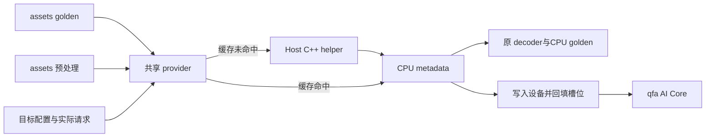

# QFA 仿真环境的 Mock AICPU 设计与 Agent 交接

更新日期：2026-10-31  
状态：当前可部署实现仍为三文件 assets 补丁与共享 provider，55 项 CPU 基线测试通过；第 22 节为独立复核，第 23—24 节为候选分析，第 25 节是下一轮实施计划（仅文档更新、尚未实现）。真实设备验收未完成。  
仓库：`/Users/fanghaolei/Workplace/agent/ops-transformer`  
原型：`scratch/qfa-metadata-mock/`  
当前实现：`/Users/fanghaolei/Workplace/agent/aicore_mock`（远端 `git@github.com:Faione/aicpu_mock.git`）

当前实现与验收清单：[qfa_mock_aicpu_status.md](/Users/fanghaolei/Workplace/agent/ops-transformer/scratch/qfa_mock_aicpu_status.md)。第 17—20 节保留旧外置方案及迭代记录，不能作为当前主路径的部署要求。

阅读顺序：第 1—16 节说明当前基线，第 17—21 节保留演进记录，第 22 节登记已有证据；下一轮实施按第 25 节执行，第 23—24 节作为其方案依据。旧记录中的零修改、跳过构建检查或启动器必选要求不覆盖当前约定。

## 1. 目标与结论

NPU 仿真环境能够执行 AI Core 内核，不能执行 AICPU。当前 QFA assets 在 golden 计划获取和设备预处理两处依赖 qfa_metadata，因此需要在 Host CPU 上计算兼容的 metadata，供原 golden 和真实 qfa AI Core 内核使用。

当前主方案是 **一个三文件 assets 补丁、共享 provider 与 Host C++ helper**。golden 显式传入 CPU 分段计划，预处理选择本地 metadata 生成函数；不再临时替换模块函数。TTK 使用原 assets 的插件路径，输入生成、Attention 与 LSE 数值计算、槽位回填及精度比较继续复用原实现。

`QFA_METADATA_CONFIG` 非空时启用 mock；未配置时保持 native，配置无效则失败。补丁由目标项目显式应用，当前工作区原 assets 尚未应用。旧外置 Spec 保留为兼容方案，不与补丁叠加。

本方案只覆盖当前 QFA 场景，不建设通用 AICPU 仿真框架。

## 2. 已确定的需求与约束

| 项目 | 约定 |
|---|---|
| 实现范围 | 第一阶段采用 MXFP8、`quant_mode=1`、正向、Eager；以现有用例为基线扩展参数化 |
| 目标平台 | 目标信息已知，由用户配置提供；已有目标名称为 mk001，设计核数为 AIC=80、AIV=80 |
| 原代码改动 | 交付一个补丁，仅修改三个 assets 文件；TTK、Torch 算子注册、生产 Host 与 AI Core 不改 |
| 数值参考 | golden 的 Attention 与 LSE 仍由 Host CPU 计算，使用与 qfa 一致的调度计划 |
| 正式执行 | qfa 仍走真实 Torch、ACLNN、Runtime 与 AI Core 仿真路径 |
| 输出要求 | 输出与现有 metadata 协议兼容，不能只有相同 shape |
| 当前交付 | 参数化 helper、共享 provider、assets 补丁与应用工具已实现；CPU 复核见第 22 节，设备验收待完成 |

mk001 的名称与 80/80 本身不能决定分块模板。实际实施时，使用用户确认的 SoC 标识、qfa 编译架构和有效核数；本文不将 mk001 自动映射为 arch92。

## 3. 当前链路与两个接入点

native 路径在 golden 和预处理阶段各调用一次 qfa_metadata。应用补丁并启用 mock 后，两处改用同一个 CPU provider：

1. TTK 生成 CPU 输入。
2. golden 从真实形参整理请求，provider 计算或复用 metadata；原 decoder 解码后，将分段计划显式传入 CPU 数值函数，计算 Out、LSE。
3. 输入写入设备后，预处理独立整理请求，从 provider 取得相同计划，写入目标设备并沿用原槽位逻辑。
4. 原 qfa AI Core 内核读取 metadata，生成真实 Out、LSE。
5. Host CPU 比较真实输出与 golden。

| 补丁文件 | 当前 mock 行为 |
|---|---|
| `impl/golden.py` | 从本次形参构造请求、取得 CPU 计划并解码，显式传给原数值函数；拒绝其他量化模式 |
| `quant_flash_attn_golden.py` | 接受可选 `metadata_plan`；存在时跳过设备计划获取，分段计算异常直接抛出 |
| `impl/npu_preprocess.py` | 在本次调用选择本地 `metadata_builder`，保留原动态返回、resize、形状检查与 copy |

未配置 mock 时保留原 native 分支。原 Spec、输入生成和 compare 不改；不使用运行时函数替换或异常桥接。

## 4. 原型与当前实现的关系

| 原型 | 当前结果 |
|---|---|
| 固定参数 generate.cpp | 已参数化为独立仓库 Host helper，按本次请求计算 |
| arch92_80_80.bin | 保留为固定回归样本，运行时不直接套用 |
| mock_spec.py | 已发展为旧外置兼容方案；当前主方案改用显式 assets 补丁 |
| validate.py | 已扩展为 provider 中的格式、覆盖、FD 与初始化标志校验 |

当前参数化实现已完成本机 CPU 验证；真实 AICPU 对拍与目标设备验证另列待办。

## 5. 当前结构

| 组件 | 实现与职责 |
|---|---|
| assets 补丁 | `patches/qfa_assets_mock.patch`，接入两个计划消费路径 |
| 显式适配 | `qfa_mock/assets.py`，交付 CPU 分段计划与目标设备 metadata |
| 请求整理 | `qfa_mock/requests.py`，从本次真实形参生成统一请求 |
| worker | `qfa_mock/worker.py`，按进程共享 provider，固定配置与构建身份 |
| provider | `qfa_mock/provider.py`，不可变 bytes 主副本、缓存、校验和独立 Tensor 交付 |
| Host helper | `cpp/metadata_helper.cpp`，复用分块及 SectionStreamK 算法 |
| 补丁工具 | `scripts/apply_assets_patch.py`，检查、应用、重复应用检测与撤销 |



主路径不加载旧外置 Spec、runtime loader 或临时函数替换；旧模块继续保留兼容回归。

## 6. 配置设计

TTK 的 `--plugin` 始终选择已应用补丁的原 assets。使用 `QFA_METADATA_CONFIG` 控制 mock；同时设置 `QFA_REPO`、`QFA_MOCK_HELPER`，通过 `PYTHONPATH` 提供 `qfa_mock`。完整操作见独立仓库 [ASSETS_USAGE.md](/Users/fanghaolei/Workplace/agent/aicore_mock/ASSETS_USAGE.md)。

```json
{
  "backend": "mock_aicpu",
  "target": {
    "name": "mk001",
    "soc_version": "<目标实际调度 SoC 标识>",
    "kernel_arch": "<目标实际 qfa 编译架构>",
    "aic_core_num": 80,
    "aiv_core_num": 80
  },
  "cache": {"enabled": true, "max_entries": 8}
}
```

- 未设置或设为空字符串：保留 native；非空但配置错误、helper 失败或请求不支持：直接失败。
- SoC、架构与有效核数由用户配置提供；不能用 mk001 或 80/80 自动推断调度架构。
- AIC、AIV 分别是有效 Cube、Vector 核数；M、S2、FD 和区间由算法计算。
- 首版使用 JSON 与进程内缓存；YAML、持久化缓存后置。
- 配置不会改变 CANN 平台或 qfa tiling。主路径只对可取得的设备容量做检查；首次目标执行仍须核对真实 tiling 与 Out、LSE。
- 旧平台证据工具为可选诊断，不是新主路径的启动要求，也不再要求使用专门启动器。

## 7. 统一调度请求

两个入口必须生成同一种请求。请求的数据来源是当前用例及实际调用参数，不能只用用例名称或原型的固定常量。

| 类别 | 字段 |
|---|---|
| 平台 | 目标 SoC 标识、编译架构、有效 AIC 与 AIV 核数 |
| 形状 | batch、`num_heads_q`、`num_heads_kv`、`head_dim`、`head_dim_v` |
| 长度 | 原始 `cu_seqlens_q`、`cu_seqlens_kv`、`seqused_q`、`seqused_kv`，以及最大长度属性 |
| 属性 | `quant_mode`、`mask_mode`、`win_left`、`win_right`、Q 与 KV 及 scale 和输出布局、`is_grad_enabled` |

整理规则：

1. 按真实 metadata 接口处理默认值、空 Tensor、batch 推导和有效长度优先级。
2. 保留原始累积长度和有效长度。即使最终有效长度相同，分配长度不同也可能改变 `needInitOutput`。
3. golden 与预处理使用相同的默认值规则。不能一处保留 `max_seqlen=-1`，另一处自行改成实际长度。
4. 原 `build_metadata_arguments` 目前未完整传递窗口等字段。非默认值必须从实际调用补齐；无法可靠取得时拒绝该组合，不能静默猜测。
5. golden 适配器从本次钩子实参整理请求，不从旧全局状态推导全部字段；原 decoder 则使用原 CPU golden 为本次调用设置的上下文。
6. 请求不包含 Q、K、V 的数值。预处理入口只有设备 Tensor 时，最多将小型长度 Tensor 读回主机；不要将 Q、K、V 全量读回。

首版从原型的 TND、PA_BNBD、mask=3、默认窗口、D=128 基础用例起步，以测试集合逐项扩大参数范围。不能因核心调度函数接受某个参数，就直接宣称现有 golden 和 kernel 的完整组合均已支持。

## 8. Host C++ helper 的计算过程

当前采用纯 Host C++ 独立可执行程序，在测试前编译完成。由 provider 传入请求并接收结果，不在用例执行过程中编译，不依赖 Torch C++ 扩展构建。

helper 不能直接编译调用依赖 `CpuKernelContext` 的 AICPU 入口。应复用纯算法头文件，并对包装层的参数整理、初始化判断和序列化实现 Host 等价适配。

| 阶段 | 必须完成的内容 | 对应源码 |
|---|---|---|
| 参数整理 | 默认值、batch、实际长度、布局和数据类型处理 | `Prepare`、`ParamsInit` |
| 分块选择 | 根据平台、head dimension、prefill 或 decode 选择 M 与 S2 | `AdjustSinnerAndSouter`、`AdjustSinnerAndSouterArch92` |
| 策略设置 | FD、L2 分段、负载均衡参数和 kernel split mode | `ParamsInit` |
| 任务分配 | 调用原负载均衡算法 | `SectionStreamK::Compute` |
| 输出初始化 | 识别零长度、padding、全 mask 行等情况 | `CheckNeedInitOutput` |
| 输出编码 | Header、FA、FD 与容量检查 | `GenMetaData`、`SetMetadataHead/Fa/Fd` |

等价性以当前源码为准。不要在移植时顺手调整分块或负载均衡策略，否则 CPU golden 与真实 kernel 可能采用不同的数值分段。

原型中固定的 `needInitOutput=0` 只适用于原样例，参数化后必须按输入计算。FD 区也不能统一填零，应依据当前平台与调度结果编码。

### helper 的交付约定

- 输入：公开接口使用 JSON 配置与请求；provider 将规范化输入转换为版本化的 C++ 私有文本协议。
- 输出：metadata 二进制及摘要，至少记录 shape、有效长度、平台、请求摘要和算法版本。
- 二进制：明确使用 little-endian int32 表示；内部字段仍按原协议的 uint32 位模式处理。
- 失败：返回清楚的错误原因，provider 将当前用例判为失败。
- 并发：每个 worker 使用独立工作目录或唯一请求目录，不覆盖其他请求的文件。

## 9. metadata 输出协议

provider 统一向调用方提供 CPU 上的连续 `int32` Tensor，形状为 `(2, rowSize)`。

| 区域 | 结构与用途 |
|---|---|
| 第一行 Header | 16 个 word |
| 第一行 FA | `sectionNum × aicNum × 16` 个 word |
| 第一行 FD | `sectionNum × aivNum × 16` 个 word |
| 第二行 | 当前正向范围内清零；不生成反向调度 |

Header 的有效槽位：

| 索引 | 含义 |
|---|---|
| 0 | sectionNum |
| 1 | isFD |
| 2 | M 基本块大小 |
| 3 | S2 基本块大小 |
| 4 | AIC 数量 |
| 5 | AIV 数量 |
| 15 | needInitOutput |

FA 记录包括 `(bn,m,s2)` 的起止区间及 FD workspace 索引；FD 记录包括归约任务位置、workspace、切分份数与行区间。每条记录占 16 个 word，预留字段清零。

容量参考当前 Torch 分配规则：

```text
rowSize = 按 4096 个元素向上对齐(
    16 + (aicNum + aivNum) × 16 × batch × numHeadsQ
)
```

4096 的单位是元素，不是字节；核数取用户目标配置，batch 按统一规则推导。编码后必须额外检查：

```text
16 + sectionNum × (aicNum + aivNum) × 16 <= rowSize
```

不能调用当前依赖 `_get_core_nums()` 的原分配路径后，再修改 Header 核数。核数同时影响容量、FA/FD 偏移、任务分配和分块规则。

## 10. 两个消费路径

### golden

1. 补丁从当前真实形参构造请求。
2. provider 生成或复用 CPU metadata；校验实际 Q、KV 有效长度后调用原 decoder。
3. 将解码结果通过 `metadata_plan` 显式传入原 CPU 数值函数。
4. 显式计划模式跳过 `get_qfa_section_info`，分段计算异常直接向上抛出；成功返回原 Out、LSE 结构。

不再安装或恢复函数替换，也不需要内部 `BaseException` 跨越 fallback。

### npu_preprocess

1. 补丁从本次真实形参构造请求，继续调用原参数整理函数。
2. 本次调用选用本地 `metadata_builder`；再次核对整理后的请求，与 golden 使用同一 provider。
3. 取得 CPU metadata，经可用容量检查后写入 `anchor.device`。
4. 原 `run` 继续处理动态槽字典返回、`(0,)` 调整、静态形状检查与 copy。

关闭 golden 时预处理仍独立生成计划。未配置 mock 时继续选择原 `run_metadata`。

## 11. 缓存与一致性

缓存以 CPU metadata 为主副本，按 worker 隔离，结果不可被 decoder 或设备回填修改。golden 与预处理共享相同内容，但不要求共享同一个可变 Tensor 对象。

缓存键至少包含：

- 目标 SoC、架构、有效核数与其他影响调度的目标参数。
- 全部已支持的调度属性与维度。
- 原始长度数组的实际值，不能只使用 shape 或最大值。
- 算法版本、metadata 格式版本。

缓存未命中时计算，命中时复用。关闭 golden 后预处理仍独立生成计划。长度变化使用新缓存键；同 worker 改变目标或构建身份则失败，重新启动 worker 后使用新身份。

两个请求字段不同，不能仅因用例名称相同而强行返回同一缓存条目。发现 golden 与预处理本应一致的请求出现差异时，应报告具体字段，而不是掩盖差异。

## 12. 错误处理与诊断

| 情况 | 处理 |
|---|---|
| 配置缺失 | 补丁主路径继续 native；非空配置无效时失败，不能回退 |
| 已知平台冲突 | 主路径检测到目标核数超出可查询容量时失败；架构和有效 tiling 仍需目标验收，不能宣称已自动确认 |
| 属性或布局尚未支持 | 明确拒绝，不读取固定样例计划代替 |
| 请求缺字段或默认值不一致 | 报告字段及来源 |
| helper 失败、输出容量不足或格式错误 | 当前用例失败，不回退真实 AICPU |
| 任务覆盖或 decoder 校验失败 | 当前用例失败，不回退全局参考计算 |

每次计划生成或缓存命中至少记录：模式、目标摘要、请求摘要、算法版本、Header、活跃核数、section 数、有效调度区长度。按需保留完整请求和 metadata，便于重现。

## 13. 验证与验收

### A. CPU 结构校验

- Header 与目标配置一致。
- 容量及 FA、FD 偏移正确。
- 任务区间合法，完整覆盖应计算区域，没有重复。
- 未使用记录与预留字段清零。
- 初始化标志和 FD 信息与算法结果一致。
- 原 decoder 能使用实际用例参数解码。

### B. 真实 AICPU 对拍

在可执行 AICPU 的设备上，使用该设备真实的 SoC、核数和相同请求，分别生成真实结果与 CPU helper 结果。

比较有效 Header、FA、FD 及分段语义，不要求未使用或未初始化区域逐字节相同。其他设备只能验证其可支持的配置；不能把较少核数设备的输出改成 80/80，充当目标平台的对拍结果。

### C. 仿真链路

- golden 与预处理均未提交真实 qfa_metadata 任务。
- 两个入口在相同请求下使用相同的计划摘要。
- golden 数值计算完整在 Host CPU 运行。
- qfa 仍由原 AI Core 内核执行，metadata 写入设备后正确回填。
- 开启与关闭 golden 均能完成计划准备。
- Out、LSE 分别通过用例容差比较。

### D. 模式隔离

未开启 mock 时，原 native 流程保持现有行为。缓存不能跨目标配置或算法版本复用。

## 14. 当前部署与验收顺序

1. 在目标操作系统与 CPU 架构上 build helper；缺少编译头文件、assets/golden 或 AICPU 参考 cpp 时立即失败，一次列出全部缺失项，不提供跳过选项。
2. 检查并应用唯一的 assets 补丁，配置真实目标和 Python 导入路径。
3. 通过原 assets 的 Spec 执行 TTK；核对两个计划入口的请求与 metadata 摘要。
4. 在目标环境核对实际 qfa tiling、metadata 写入与 AI Core 仿真，分别比较 Out、LSE。
5. 在支持 AICPU 的环境完成同配置对拍；与目标不同的平台单独登记，不充当 mk001 对拍。

本机已完成的 CPU 项目与证据见第 22 节。当前工作区原 assets 未自动应用补丁。

## 15. 源码导航

以下链接使用当前工作区绝对路径。仓库迁移后，以同名相对路径定位。

| 内容 | 位置 |
|---|---|
| 原型说明 | [scratch/qfa-metadata-mock/README.md](/Users/fanghaolei/Workplace/agent/ops-transformer/scratch/qfa-metadata-mock/README.md) |
| 原型 CPU helper | [generate.cpp](/Users/fanghaolei/Workplace/agent/ops-transformer/scratch/qfa-metadata-mock/generate.cpp) |
| 原型替换方式 | [mock_spec.py](/Users/fanghaolei/Workplace/agent/ops-transformer/scratch/qfa-metadata-mock/mock_spec.py) |
| 原型 decoder 校验 | [validate.py](/Users/fanghaolei/Workplace/agent/ops-transformer/scratch/qfa-metadata-mock/validate.py) |
| golden 计划入口 | [get_qfa_section_info](/Users/fanghaolei/Workplace/agent/ops-transformer/attention/quant_flash_attn/tests/assets/quant_flash_attn_golden.py:875) |
| 原设备计划获取 | [_build_qfa_section_info](/Users/fanghaolei/Workplace/agent/ops-transformer/attention/quant_flash_attn/tests/assets/quant_flash_attn_golden.py:910) |
| 分段 decoder | [_decode_qfa_sections](/Users/fanghaolei/Workplace/agent/ops-transformer/attention/quant_flash_attn/tests/assets/quant_flash_attn_golden.py:994) |
| 预处理参数整理 | [build_metadata_arguments](/Users/fanghaolei/Workplace/agent/ops-transformer/attention/quant_flash_attn/tests/assets/impl/npu_preprocess.py:113) |
| 预处理 metadata 调用 | [run_metadata](/Users/fanghaolei/Workplace/agent/ops-transformer/attention/quant_flash_attn/tests/assets/impl/npu_preprocess.py:208) |
| 原槽位回填 | [run](/Users/fanghaolei/Workplace/agent/ops-transformer/attention/quant_flash_attn/tests/assets/impl/npu_preprocess.py:238) |
| AICPU 计算入口 | [Compute](/Users/fanghaolei/Workplace/agent/ops-transformer/attention/quant_flash_attn_metadata/op_kernel_aicpu/quant_flash_attn_metadata_aicpu.cpp:29) |
| 参数与策略 | [ParamsInit](/Users/fanghaolei/Workplace/agent/ops-transformer/attention/quant_flash_attn_metadata/op_kernel_aicpu/quant_flash_attn_metadata_aicpu.cpp:151) |
| 输出初始化判断 | [CheckNeedInitOutput](/Users/fanghaolei/Workplace/agent/ops-transformer/attention/quant_flash_attn_metadata/op_kernel_aicpu/quant_flash_attn_metadata_aicpu.cpp:948) |
| metadata 编码 | [GenMetaData](/Users/fanghaolei/Workplace/agent/ops-transformer/attention/quant_flash_attn_metadata/op_kernel_aicpu/quant_flash_attn_metadata_aicpu.cpp:1021) |
| metadata 协议 | [quant_flash_attn_metadata.h](/Users/fanghaolei/Workplace/agent/ops-transformer/attention/quant_flash_attn_metadata/op_kernel_aicpu/quant_flash_attn_metadata.h:24) |
| 纯 CPU 调度函数 | [SectionStreamK::Compute](/Users/fanghaolei/Workplace/agent/ops-transformer/attention/common/op_kernel/load_balance/section_stream_k/section_stream_k.h:32) |
| 分块函数 | [qfa_adjust_sinner_souter.h](/Users/fanghaolei/Workplace/agent/ops-transformer/attention/quant_flash_attn/op_host/qfa_adjust_sinner_souter.h:49) |
| 当前 metadata 容量计算 | [_calculate_max_schedule_size](/Users/fanghaolei/Workplace/agent/ops-transformer/attention/quant_flash_attn/torch_extension/quant_flash_attn.py:86) |
| Host 查询有效核数 | [aclnn_quant_flash_attn_metadata.cpp](/Users/fanghaolei/Workplace/agent/ops-transformer/attention/quant_flash_attn_metadata/op_host/op_api/aclnn_quant_flash_attn_metadata.cpp:60) |
| 原 Spec 与懒加载器 | [spec.py](/Users/fanghaolei/Workplace/agent/ops-transformer/attention/quant_flash_attn/tests/assets/spec.py:29) |
| TTK 的插件文件发现 | [SpecLoader](/Users/fanghaolei/Workplace/agent/ops-test-kit/ttk/core_modules/common/plugin/spec_loader.py:148) |
| TTK 的继承属性读取 | [get_spec_attr](/Users/fanghaolei/Workplace/agent/ops-test-kit/ttk/core_modules/common/plugin/spec_manager.py:64) |
| CPU、AICPU、AI Core 分工依据 | [qfa_ttk_multi_round_analysis.md](/Users/fanghaolei/Workplace/agent/ops-transformer/scratch/qfa_ttk_multi_round_analysis.md) |

## 16. 当前交接检查

- [x] 参数化 Host helper、完整 metadata 编码和结构校验。
- [x] 真实参数整理、共享 provider、不可变缓存和 worker 配置固定。
- [x] 三文件补丁与检查、重复应用、撤销工具。
- [x] 补丁后的原 CPU golden：基线、变长、padding、零长、FD、多 section。
- [x] 原预处理 CPU 槽位矩阵：动态、零长占位、静态匹配和不匹配。
- [x] mock 错误直接失败；未配置时保留 native 分支选择。
- [x] 真实 TTK SpecLoader 发现补丁后的原 Spec。
- [x] 本次 55 项 CPU 测试通过，260 个上游 Python 文件摘要不变。
- [ ] 当前工作区正式应用补丁：尚未执行，只完成适用性检查与临时副本验收。
- [ ] mk001 调度 SoC、架构及实际有效核数确认。
- [ ] 真实 AICPU 同配置对拍。
- [ ] metadata 实际写入仿真设备、qfa tiling 与 AI Core Out/LSE 精度验证。

第 17—20 节保留旧方案及历史快照；其中原 assets 零修改、三处局部替换、强制离线记录等要求不再适用于补丁主路径。

## 17. 兼容方案：外置 Spec 零源码修改接入

本节仅适用于未应用补丁的旧外置兼容路径，不与新主方案叠加。

### 17.1 接入决策与可行性

在原 assets 零修改的要求下，采用 **外置 Spec 接管钩子，再在调用作用域内替换 metadata 获取函数**。原始 `npu_preprocess.py` 不被覆盖或改名，TTK 也不新增参数。

当前代码支持这一方式：

1. TTK 的 `--plugin` 支持直接指定一个 `.py` 文件。
2. Spec 属性通过 `getattr` 获取，能够继承原类的输入、compare 和容差。
3. 原 `npu_preprocess.run` 在执行时查找其模块内的 `run_metadata`，可在本次调用期间替换该依赖。
4. CPU golden 通过模块内的 `get_qfa_section_info` 获取分段，可在本次数值计算期间替换该依赖。
5. 原型 `mock_spec.py` 已采用上述两个局部替换点，但其固定形状、二进制计划与目标检查尚需参数化。

首版继续限定 MXFP8 正向 Eager。这里复用的是 Python 模块属性查找行为，不是 TTK 已存在的“按路径替换某个源文件”功能。

### 17.2 外置目录及文件职责

以下按职责展示建议目录。当前实现已合并为 `ttk_plugin.py` 与 `qfa_mock` 包，不要求按示例重新拆文件：

```text
qfa_mock_plugin/
├── spec.py
├── runtime_loader.py
├── request_adapter.py
├── npu_preprocess.py
├── golden_adapter.py
├── metadata_provider.py
└── target.json
```

| 文件 | 职责 |
|---|---|
| `spec.py` | 注册原 qfa API 对应的新 Spec，继承原 `QuantFlashAttnSpec`，覆盖 golden 与 npu_preprocess |
| `runtime_loader.py` | 按明确路径加载原 Spec、原实现和外置支持模块，维护稳定模块身份与 worker 内共享锁 |
| `request_adapter.py` | 从两个钩子的实际参数构造统一请求，校验长度、默认值和已支持范围 |
| `npu_preprocess.py` | 外置预处理入口，局部替换原 `run_metadata`，调用原 `run` 并原样返回结果 |
| `golden_adapter.py` | 外置 golden 入口，局部替换原 `get_qfa_section_info`，调用原 CPU golden |
| `metadata_provider.py` | 适配正在实现的 CPU mock，统一配置、CPU metadata 缓存、协议校验与摘要 |
| `target.json` | 用户提供的目标平台配置，沿用第 6 节约定 |

文件可以合并，但加载、请求整理与 mock 输出交付的职责应保持清楚。两个适配器必须访问同一个 provider，不各自实例化 mock 引擎。

### 17.3 Spec 注册与原行为复用

外置 Spec 类建议命名为 `QuantFlashAttnMockSpec`，继承原 `QuantFlashAttnSpec`。

| 项目 | 外置 Spec 的行为 |
|---|---|
| API 映射 | 将 `torch.ops.cann_ops_transformer.quant_flash_attn` 映射到新 Spec |
| 注册形式 | `__spec__` 为顶层字面量字典，映射值使用类名字符串，满足 TTK 的 AST 扫描规则 |
| 输入生成 | 继承原 `customize_inputs` |
| compare 与容差 | 继承原实现 |
| golden | 覆盖为外置 `golden_adapter` 入口 |
| npu_preprocess | 覆盖为外置预处理入口 |
| 主算子 | 保持 TTK 直接执行原 qfa API |

启动时只将 `--plugin` 指向外置 `spec.py`，不要同时传入原 assets 搜索目录。这样避免同一 API 的多个 Spec 竞争发现顺序。外置 Spec 在内部按明确路径加载原类，继承需要的行为。

首版不承诺 graph、compile 或独立 qfa_metadata 用例。原类中可继承到的 graph 属性不代表这些模式已完成 mock 接入验收。

### 17.4 加载与生命周期

**注册阶段：**

- 加载外置 Spec 与原类，保留原 Spec 现有的注册行为。
- 外置层不额外加载原 golden 数值模块、不创建设备 Tensor、不调用 helper，也不主动查询 NPU。
- 此时不安装函数替换，不生成用例计划。

**worker 首次调用阶段：**

- 解析配置，固定本 worker 的目标配置。
- 按需加载对应原实现模块和外置支持模块，创建 provider 与共享锁。
- 核对模块文件路径、目标函数是否存在及签名是否兼容。

**每次钩子调用阶段：**

- 绑定实际参数，形成请求。
- 持有共享锁，保存原函数对象，安装本次回调，调用原实现。
- 成功或异常退出时均恢复原函数对象，释放锁。

TTK 导入的 Spec 模块本身不自动注册进 `sys.modules`。不要依靠该临时模块名让其他模块寻找共享状态；外置支持模块应通过稳定包名或受控加载器注册、缓存。其包名已经存在时，也必须核对来源目录。

原 assets 的实现模块采用 `qfa_assets_impl_*` 等固定名称。加载器应检查已缓存模块的 `__file__` 是否属于预期 checkout，不得误用另一个仓库路径加载的同名模块。原 Spec 本身使用稳定、与路径关联的别名加载，避免重复导入出多个原类及模块状态。

### 17.5 golden 适配的完整过程

1. 确认本次量化模式和属性属于已支持范围，取得原 MXFP8 CPU golden 函数。
2. 使用该函数的真实签名绑定本次位置参数和关键字参数；将 `cu_seqlens_q_t` 等 golden 形参名映射到统一请求字段。
3. 从本次已生成的 CPU 输入取得长度，使用原始主算子属性形成请求。原 decoder 的模块上下文不作为全部请求字段的数据来源。
4. 在共享锁作用域内，将 **原数值模块对象**的 `get_qfa_section_info` 临时替换为回调，同时为 `_cpu_mxfp8_golden_sectioned` 安装局部异常保护。替换的是原 CPU golden 实际引用的模块。保护只包装异常，不改参数、返回值或数值计算。
5. 调用原 CPU golden。它仍执行自己的输入适配、本次用例上下文设置及数值计算。
6. 原数值计算请求分段时，回调核对收到的 Q、KV 有效长度与当前请求一致，从 provider 获取 CPU metadata，再调用原 `_decode_qfa_sections`。
7. 确认计划已消费、解码结果非空、分段函数已成功返回。分段计算的普通异常通过保护逃出原 fallback，并在外置钩子转成普通 `MockError`；不捕获用户中断和进程退出。
8. 返回原 CPU golden 的原始结果结构，包括开启时的 LSE；成功或失败都恢复两个被临时替换的函数。

mock 回调不调用原 `get_qfa_section_info`，因此不进入旧缓存、`_HAS_NPU`、`.npu()`、真实 metadata 调用、计划读回和异常回退路径。回调失败应向上抛出，不返回 `None` 使原数值计算改用全局分段。

缓存属于 provider。只有原 CPU golden 为本次输入设置好上下文之后，才调用依赖这些上下文的 decoder；不得在外置模块导入阶段提前解码。

### 17.6 预处理适配的完整过程

1. 通过原 `run` 的签名绑定本次 qfa 实参，形成统一调度请求。窗口、最大长度等属性从实际绑定参数取得。
2. 按统一布局规则处理原始长度和空槽。设备长度需要读取时，只读这些小型 Tensor，不读回 Q、K、V。
3. 在共享锁作用域内，将 **原预处理模块对象**的 `run_metadata` 临时替换为回调。
4. 调用原 `run`，保留原参数整理及输入处理逻辑。
5. 原 `run` 调用回调时，回调取得 provider 的 CPU metadata。对照原整理结果核对关键字段，保证本次请求未因适配而变化。
6. 回调将 metadata 写入 `anchor.device`，返回连续的 int32 设备 Tensor。动态槽时原函数传入 Q 作为锚点，静态槽时传入 metadata Tensor；不能直接将 CPU Tensor 返回给原槽位流程。
7. 原 `run` 继续执行动态槽字典返回、零长占位调整、静态槽检查和复制。
8. 外置预处理入口原样返回原 `run` 的结果，始终恢复原 `run_metadata`。

外置入口不自行重复进行槽位回填，也不吞掉原 `run` 的返回字典。请求中的窗口等字段应从外置钩子完整入参取得，不能只依赖当前不完整的 `build_metadata_arguments` 返回字典。

若用户已有一个完整且符合原钩子签名及返回约定的替代 `npu_preprocess.py`，外置 Spec 也可直接调用其 `run`。本方案优先使用薄封装，避免复制原文件后长期维护两套输入和槽位逻辑。

### 17.7 请求、输出与共享状态约定

沿用第 7—11 节的数据协议，同时落实以下要求：

- provider 不承担猜测调用方参数的职责；两个适配器先形成统一请求。
- 长度以本次输入 Tensor 的实际内容为准。CSV sidecar 值可参与校验或原规则允许的兜底，不能覆盖不同的真实 Tensor 值。
- golden 与预处理的布局过滤、默认值和最大长度语义一致；请求差异必须定位具体字段。
- CPU metadata 是不可变主副本。decoder 只读；写入设备时不修改该缓存对象。
- provider、配置、请求摘要和锁按 worker 隔离。不同目标或算法版本的持久化缓存分开命名。
- 关闭 golden 时，预处理钩子仍独立加载 provider、构造请求和生成计划，不依赖先执行 golden 来初始化全局变量。

### 17.8 替换范围与并发约定

采用两个计划接管点，加一个 golden 失败保护点；仅允许以下三处局部替换：

| 调用作用域 | 被替换对象 |
|---|---|
| 一次 golden 调用 | 原数值模块的 `get_qfa_section_info` |
| 一次预处理调用 | 原预处理模块的 `run_metadata` |
| 一次 golden 调用 | 原数值模块的 `_cpu_mxfp8_golden_sectioned`，只包装异常，不改参数、返回值或数值计算 |

原 `cpu_mxfp8_golden` 在分段计算周围存在 `except Exception`。只接管计划获取不能保证计算失败后停止，因此保留第三处保护，不为满足“两处”数量限制而删除它。内部专用 `BaseException` 仅用于跨过这段捕获，必须在外置钩子内转换为普通异常；不得让其逃到 TTK。回调返回空计划、分段函数未成功执行也必须失败。

不修改原文件，不替换整个 `torch.ops`，不改变原 Spec 的 `ASSET_IMPL_DIR`，也不将 mock 模块永久注册为原 `qfa_assets_impl_npu_preprocess`。

两个钩子共用一个 worker 内的可重入锁，保护保存、替换、原实现调用和恢复的完整过程。必须验证异常恢复后函数对象与进入前相同。

首版采用一个 worker 同一时刻执行一个用例，不在同一解释器混跑 native 用例。局部函数替换仍是进程内共享状态，锁只保护受控入口，不会自动让整个原 assets 的模块全局变量支持多线程并发。需要并发时，优先使用独立 worker 进程。

适配前检查所需函数、模块路径和签名；与当前原型或被验证源码不一致时明确失败，不静默切回原 AICPU 路径。记录实际加载文件和原源码摘要，便于定位上游变化。

### 17.9 启动约定

实现完成后，native 与 mock 通过插件路径切换：

| 模式 | `--plugin` 选择 |
|---|---|
| native | 原 `attention/quant_flash_attn/tests/assets` |
| mock | 外置 `qfa_mock_plugin/spec.py` 文件 |

以下保留按职责命名的调用示例，路径和目标名称需按部署环境填写。当前实现的实际入口为 `/Users/fanghaolei/Workplace/agent/aicore_mock/ttk_plugin.py`，应参考该仓库的 `ASSETS_USAGE.md` 设置 helper 和配置路径：

```bash
export QFA_REPO=/Users/fanghaolei/Workplace/agent/ops-transformer
export QFA_METADATA_CONFIG=/path/to/qfa_mock_plugin/target.json
export SIM_SOC='<CANN 已注册的目标 SoC 名称>'

cd /Users/fanghaolei/Workplace/agent/ops-test-kit
python3 -m ttk e2e \
  --backend npusim --sim-soc "$SIM_SOC" \
  -i "$QFA_REPO/scratch/ttk-e2e-flow/qfa_mxfp8_lse.csv" \
  --plugin /path/to/qfa_mock_plugin/spec.py \
  --golden-mode Enable
```

`QFA_REPO` 明确原 assets 的来源；`QFA_METADATA_CONFIG` 仅由外置插件读取。外置插件缺少目标配置、无法加载 mock 引擎或发现不支持的用例时，直接使用例失败。选择原 assets 路径恢复 native 行为，无需撤销源文件修改。

### 17.10 接入验收矩阵

| 场景 | 预期结果 |
|---|---|
| TTK 插件发现 | qfa API 实际映射到外置 Spec，输入与 compare 继承正常 |
| golden 开启 | 计划来自 mock，使用原 decoder 和原 CPU 数值计算，返回 Out、LSE |
| golden 关闭 | 预处理仍独立生成并回填 metadata |
| 动态 metadata 槽 | 原 `run` 返回的字典完整传给 TTK |
| `(0,)` 占位 | 按原规则调整后复制 |
| 静态槽匹配 | 沿用原复制路径 |
| 静态槽不匹配 | 沿用原形状错误，异常后恢复函数 |
| helper 或 decoder 失败 | 用例失败，无真实 AICPU 或全局参考回退，替换均已恢复 |
| 同请求的两个入口 | CPU metadata 内容及请求、计划摘要一致 |
| 后续用例改变长度 | 缓存按新请求失效，无前一用例上下文残留 |
| native 单独启动 | 原插件流程正常，未加载外置替换 |
| 原源码完整性 | 原 assets 与 TTK 被依赖文件的内容摘要前后不变 |

在测试中给真实 qfa_metadata 调用设置“触发即失败”的检测点，分别覆盖 golden 和预处理路径；生产 mock 工作流仍不全局替换 `torch.ops`。最终还要实际执行 AI Core 仿真，分别验证 Out、LSE。

原源码完整性检查仅覆盖本方案承诺不修改的文件，不要求整个工作区没有其他 agent 对 mock 引擎的实现改动。

### 17.11 可观测性与交付内容

外置插件加载和每次调用至少记录：

- 外置 Spec、原 Spec、原实现模块的实际文件路径与版本摘要。
- 模式、量化模式、目标配置摘要、统一请求摘要。
- mock 引擎来源、缓存命中、计划摘要与 Header。
- 是否完成局部替换恢复；出错阶段是参数整理、计划生成、解码、设备写入还是槽位处理。

接入实现的交付包括：外置模块、配置样例、调用说明、支持用例清单、验收记录，以及原 assets 与 TTK 未修改的检查结果。现有固定二进制仅保留作回归样本。

### 17.12 与整模块劫持、直接改源码的关系

| 方案 | 使用位置 |
|---|---|
| 外置 Spec 加局部函数替换 | 当前零源码修改目标下的主方案 |
| 外置 Spec 直接调用完整替代预处理模块 | 已有独立实现并愿意维护全部钩子行为时可用；仍需覆盖 golden |
| `sys.modules` 注入原固定模块名 | 当前懒加载器先查 `sys.modules`，技术上可行；依赖内部模块名和加载顺序，本方案不采用 |
| 修改原 assets 两处入口增加显式分支 | 未来允许维护源码集成点时的备选方案 |

单纯在 `PYTHONPATH` 放置另一个同名文件不能覆盖当前加载，因为原 Spec 使用明确文件路径构造加载器。改变 `ASSET_IMPL_DIR` 会同时影响其他实现模块，也不作为本方案入口。

独立执行 qfa_metadata 自身的 CSV 是另一条被测 API 入口，不能由这里的 qfa 两个钩子自动覆盖；如后续需要，应单独设计外置 Spec 和执行适配。本节的验收针对 qfa Eager 的内部 metadata 依赖。


## 18. 当前实现与迭代进度（2026-10-29）

独立实现位于 `/Users/fanghaolei/Workplace/agent/aicore_mock`，初始提交为 `7072d5d`。本节对齐第 17 节的新接入方案；目录和文件允许合并，当前插件文件为 `ttk_plugin.py`，支持包为 `qfa_mock`。详细状态见 [PROGRESS.md](/Users/fanghaolei/Workplace/agent/aicore_mock/PROGRESS.md)。

### 18.1 已完成的首版内容

- Python 配置/请求/provider、Host C++ helper、版本化公开 JSON 契约和二进制输出已实现。
- 复用原分块函数及 `SectionStreamK::Compute`，生成完整 Header、FA、FD 和初始化标志；未修改生产调度策略。
- 一次性自包含输入；无历史 KV cache 追加、跨轮状态或新请求加入。当前支持范围为 MXFP8、quant_mode=1、正向 Eager、D=Dv=128、Q/scale/Out=TND、KV=TND 或 PA_BNBD、mask=0/3/5、默认窗口；最大长度必须显式为正。
- 不可变 CPU bytes 主副本、进程内缓存、长度/目标/版本失效和独立 Tensor 交付已实现。
- 外置 Spec 继承原输入与 compare，接管 golden 和预处理两个计划入口；保留原 run 的返回及槽位处理路径。
- 已按新约定修正模式选择：选中 mock 插件但缺配置时直接失败，native 使用原 assets 的插件路径，不自动回落。
- 18 项 CPU 测试通过，arch92 80/80 基线与旧原型二进制逐字节一致；FD、多 section、变长、padding、零长等结构校验通过。
- 本轮测试前后，16 个 QFA assets Python 文件及 5 个 TTK 插件相关文件（共 21 个）SHA-256 一致。此结论仅针对本轮检查，不代表对其他历史改动的审计。

验证记录：[verification_latest.json](/Users/fanghaolei/Workplace/agent/aicore_mock/docs/verification_latest.json)、[cpu_tests_latest.txt](/Users/fanghaolei/Workplace/agent/aicore_mock/docs/cpu_tests_latest.txt)。

### 18.2 部分完成与新版差异

| 项目 | 当前情况 | 下一步 |
|---|---|---|
| 加载与稳定模块身份 | 支持包稳定；原 Spec 使用固定别名，尚未按路径关联 | 补 runtime loader，校验缓存模块 __file__、函数和签名 |
| worker 配置 | provider 按 PID 隔离；同 worker 配置变化会重建 | 按新版要求固定 worker 配置并拒绝变化 |
| 替换范围 | 除两个计划入口，还临时包装 `_cpu_mxfp8_golden_sectioned` 使其异常逃出原内部 fallback | 此前与“两处替换”约束存在差异；第 17.8 节现已修订，允许保留第三处局部异常保护；补成功标志、异常转换与恢复验收 |
| 设备槽位与异常恢复 | 替身通过部分控制流；未运行原 hook 的完整槽位矩阵 | 补动态、零长、静态匹配/不匹配与异常恢复，测试中设置真实 metadata 触发即失败的检测点 |
| 日志 | 有模式、目标、请求、Header、活跃核数和缓存摘要 | 补原模块实际路径/摘要、替换恢复结果和错误阶段 |
| 配置与持久化 | 仅 JSON 和进程内缓存 | YAML、持久化缓存为后续扩展，未标记完成 |

### 18.3 未完成的设备验收

- mk001 对应的真实 SoC、编译架构、有效核数尚未在当前实现中确认，示例 80/80 不能充当确认。
- 未执行真实 TTK 插件发现与原 CPU golden Out/LSE 数值链路。
- 未执行真实 AICPU 对拍、H2D、AI Core 仿真及 Out/LSE 精度比较。
- 本机无 Torch/CANN/NPU，以上内容不得以 CPU 替身测试代替验收。

实施阶段状态：第 1 项部分完成；第 2、3 项首版完成；第 4 项原型完成但 worker 生命周期待补；第 5 项部分完成；第 6 项仅 CPU 部分完成；第 7 项未开始。优先补加载与生命周期、异常保护验收及原 hook 接入矩阵；目标平台确认可并行进行。详细顺序和退出条件见第 19 节。


## 19. 更新后评估与优化决策（2026-10-29）

已核对独立仓库的 PROGRESS、接入说明、契约、实现及测试。详细交接见 [qfa_mock_aicpu_review.md](/Users/fanghaolei/Workplace/agent/ops-transformer/scratch/qfa_mock_aicpu_review.md)。本节及评审文档给出下一轮设计决策，不将建议记为已实现。

| 未解决事项 | 本次决策 |
|---|---|
| 第三处 golden 包装是否必须移除 | 保留为明确允许的异常保护；修订第 17.8 节，不改变数值函数本体 |
| 加载与配置生命周期 | 按解析后的绝对路径校验模块来源；同 worker 固定源仓库、规范化配置和 helper 身份，变化即失败 |
| 目标运行时校验 | 区分仿真器标识、CANN 平台名、调度 SoC 和编译架构；比较规范化平台属性与有效核数，不直接比较不同命名体系的字符串 |
| 设备属性查询不可用 | 允许以绑定当前运行的离线平台与构建记录替代；不能仅填配置后跳过兼容性检查 |
| JSON、YAML 与缓存 | JSON 和进程内缓存足以支持首轮设备接入；YAML、持久化缓存后置 |
| 验收顺序 | 加载与失败恢复 → 原 hook 与 CPU golden → 同配置真实对拍 → 目标仿真；无目标硬件时单独记录目标对拍缺失 |

本次复跑现有 18 项 CPU 测试全部通过。另从原 `cpu_qfa_mxfp8`、`npu_preprocess.run` 提取真实签名，绑定现有基线 CSV，两个适配器生成的规范化请求一致；该检查未执行原函数体、Torch 数值计算或设备调用。实现基线包含 `7072d5d` 后的未提交修改，不仅是该提交内容。


## 20. 实现完成与验收更新（2026-10-29）

最新实现与验收记录位于独立仓库，详细见 [PROGRESS.md](/Users/fanghaolei/Workplace/agent/aicore_mock/PROGRESS.md)。第 18 节与本节均保留为旧外置方案的历史快照，当前主方案见第 21—22 节。

### 20.1 已完成

- 已按第 19 节决策保留两个计划接管点与第三处 golden 异常保护，三处均在成功及失败路径恢复。
- 原 Spec 以解析路径摘要命名并复用；实现、数值模块及支持包均检查来源、源码摘要与签名；拒绝同解释器切换 checkout。
- worker 固定 PID、规范化配置、helper 路径和构建身份；语义变化失败，JSON 排版及相同配置迁移可复用，fork 重置锁和 provider。
- golden 只有一次计划消费、非空解码、一次分段计算成功返回时才接受；普通数值异常在边界转换为 MockError，保留原始原因；用户中断/退出不转换。
- 平台预检采用与实际启动命令和环境绑定的离线模型/平台/构建记录，校验产物摘要、NpuArch、有效核数及调度规则；可核对真实 tiling 和 FD 容量。运行时 SoC 使用有来源的类型化别名，总核数仅作容量检查；无证据或明确冲突时失败。
- `prepare_platform_evidence.py` 打包真实部署记录，`qfa_mock launch` 按完全相同 argv 启动 TTK；无跳过校验开关。JSON 与进程内缓存保持首版范围。
- 结构化日志记录源路径/摘要、worker、请求/计划摘要、失败阶段和恢复结果；本次预处理复用已生成的 MetadataResult。

### 20.2 本机实际验收

- Python 3.12.16、CPU Torch 2.9.0、NumPy 1.26.4：41 项测试全部通过，无跳过。
- 真实执行原 `npu_preprocess.run` 的动态槽、零长占位、静态匹配及不匹配分支；使用真实 CPU Tensor，仅绕过设备平台证据边界，不记为 H2D。
- 真实执行原输入生成、CPU golden 的输入适配、decoder、分段数值和输出整理：基线、变长、padding、零长、FD、多 section 共 6 组；Out/LSE 保留原 FP32 返回语义。
- 真实 TTK SpecLoader 发现外置 Spec，输入/compare/容差继承通过；原 native Spec 仍可独立发现。
- 测试中真实 metadata 和设备入口触发即失败；torch_npu 仅为导入替身，不替换任何数值运算。故障注入覆盖 decoder、数值计算及外层输出处理，原函数对象均恢复。
- 本轮测试前后，QFA assets 与 TTK 共 260 个 Python 文件 SHA-256 一致。

证据：[verification_latest.json](/Users/fanghaolei/Workplace/agent/aicore_mock/docs/verification_latest.json)、[cpu_tests_latest.txt](/Users/fanghaolei/Workplace/agent/aicore_mock/docs/cpu_tests_latest.txt)。

### 20.3 目标环境仍需完成

mk001 的真实 SoC/架构/有效核数与安装映射待部署方确认。真实 AICPU 同配置对拍、H2D、实际 qfa tiling 与 AI Core 仿真 Out/LSE 精度尚未运行，不能用本机 CPU 记录替代。普通 SDK 设备属性不能独立证明有效核数和构建身份；首版默认采用离线记录与实际启动绑定。目标操作流程见独立仓库 ASSETS_USAGE.md / PLATFORM_EVIDENCE.md。


## 21. 允许 assets 补丁的简化方案（2026-10-30）

本轮按用户授权，将“原 assets 零修改”改为“允许维护一个 assets 补丁文件”。以下为新的主方案，覆盖旧方案中外置 Spec 和平台启动器为必选项的约定。

## 决策

1. 保留 Host C++ helper、统一请求、共享 provider、metadata 协议和 CPU 校验，不重写分核算法。
2. 新增一个统一补丁 `patches/qfa_assets_mock.patch`，只修改三个测试资产文件：impl/golden.py、quant_flash_attn_golden.py、impl/npu_preprocess.py。TTK、Torch 注册、生产 Host/AI Core 均不改。
3. impl/golden.py 从本次真实形参整理请求，取得并解码 CPU metadata，将分段计划作为可选显式参数传给原数值函数；数值函数在显式计划模式下直接抛出异常，不进入原设备计划获取或全局参考回退。原 Attention、LSE 和输出整理保持原样。
4. 预处理在 mock 分支从本次真实形参整理请求，选择一个本地 metadata 生成函数，沿用原 run 的动态/静态槽位处理；不改模块函数、不依赖 golden 先执行。
5. `QFA_METADATA_CONFIG` 非空即启用补丁中的 mock 分支；缺省保持原 native。给定配置但文件无效、请求不支持或 helper 失败则报错。两个分支延迟导入 qfa_mock，不初始化 NPU。
6. TTK 使用原 assets 的 --plugin 路径。无需外置 Spec、运行时函数替换、异常桥接、原类加载器或启动回执。旧外置方案保留兼容，不与新补丁叠加。
7. 主方案目标平台由显式配置提供；可用设备查询仅用于已知的容量/明确 SoC 冲突检查，不能自动证明有效核数或编译架构。首次目标仿真仍核对真实 tiling / Out / LSE。旧离线平台证据工具降为可选诊断，不再是简化路径的启动前置条件，不宣称目标已验收。
8. 按用户最新纠正，build 不调用 Git，但强制检查编译头文件、assets/golden 和 AICPU 参考 cpp，必须一次明确列出全部缺失文件、绝对路径、分组及用途。缺少任一项都停止构建，不提供跳过检查选项。实际编译清单和运行时指纹仍只包含真正编译的依赖，不绑定 Git 或整棵仓库。

## 实施与验收

- 先同步本计划到主设计，再实现 assets 适配、统一补丁及应用工具。
- 在无 .git、路径含空格的完整源码副本验证构建及 helper 基线通过；逐类删除头文件、assets/golden、AICPU 参考 cpp，必须在调用编译器前失败并报告全部缺失项；检查或编译失败均不覆盖已有产物。
- 在临时复制的上游 assets 应用和撤销同一个补丁；直接执行补丁后的原函数，禁止依赖 monkeypatch 计划生产函数。
- mock 下验证双入口请求/计划相同、数值基线/变长/padding/零长/FD/多 section、动态/静态槽，以及 decoder/数值/helper 错误不回退。
- 无配置时验证原计划入口和原预处理仍被选择；真实 metadata 在 mock 测试中触发即失败。
- 更新操作说明、进度和 CPU 证据，提交并推送远端。补丁交付后由目标项目显式应用；本地原上游 assets 不自动改写。
- 真实 AICPU、H2D 和 AI Core 精度继续单列为目标环境验收，不能用 CPU 结果替代。


### 21.1 简化方案实施结果（2026-10-30）

主方案已改为一个 assets 补丁与共享 provider；51 项 CPU 测试通过。当前决策与实现见第 21 节，真实设备验收未完成。

- 已交付一个三文件 assets 补丁、显式适配模块和应用/撤销工具；原 Spec 直接执行，不依赖外置函数替换或异常桥接。
- build 直接编译，使用编译器实际依赖清单；无 .git、assets、AICPU cpp 的最小头文件目录也能构建并运行。旧 SOURCE_MISSING 来自完整源码检查，不是 Git 检查；此编译前检查已移除。
- worker 与请求规范化提取为独立小模块，简化路径不导入旧 integrations 或 runtime_loader。
- 51 项 CPU 测试通过，0 失败/错误/跳过。补丁路径与旧路径六组 Out/LSE 摘要逐项一致；动态/静态槽、native 选择、失败不回退、补丁字节级撤销已验证。
- 260 个原上游 Python 文件测试前后摘要不变，补丁只在临时副本应用。目标项目部署时显式执行 apply_assets_patch.py；真实 AICPU、H2D 和 AI Core 精度仍待目标环境。
- 更新后的使用流程见 ASSETS_USAGE.md，测试记录见 docs/verification_latest.json。第 21 节覆盖旧方案中的零源码修改和强制启动证据约定。


### 21.2 build 缺失检查修正（2026-10-30）

按用户最新要求，恢复默认源码完整性检查；本节覆盖 21.1 中“编译前检查已移除”的构建行为说明。

- build 仍不调用 Git，不要求 .git 或提交历史。默认检查编译头文件、assets/golden 和 AICPU 参考 cpp，共三组。
- 检查失败返回 SOURCE_MISSING，一次列出所有缺失项；error.repo 为源码根目录，error.missing 每项包含 group、relative_path、绝对 path 和 required_for。message 同时给出可读列表和源码根目录提示。
- 编译头文件用于生成 helper；assets/golden 用于后续 TTK 和 CPU 校验；AICPU cpp 作为参数包装行为参考，不参与 helper 编译。
- 显式 --compile-only 仅检查编译头文件，允许最小头文件目录构建；未列入清单的额外 include 缺失由编译器报告。实际编译指纹仍只覆盖真正引用的依赖。
- 检查或编译失败不覆盖已有 helper/清单。无 .git 的完整源码检查、缺失清单、CLI 结构化错误、最小目录编译均已验证。
- 当前 54 项 CPU 测试通过，0 失败/错误/跳过；260 个上游 Python 文件不变。TTK 流程及目标设备待验收事项保持原计划。


### 21.3 必需源码不可跳过（2026-10-30）

按用户最新纠正，移除 21.2 引入的 --compile-only。所有 build 入口必须检查编译头文件、assets/golden、AICPU 参考 cpp，缺少任一项就停止构建，不调用编译器，不修改已有 helper 或清单，并返回包含全部缺失项的 SOURCE_MISSING。此前仅有头文件目录可构建的说明已失效。

这三组文件是交付构建的强制前置条件；实际 C++ 编译依赖摘要仍由编译器生成。build 不调用 Git，也不要求 .git 或提交历史。TTK 使用流程保持不变。

验收覆盖完整源码无 Git 构建、带空格路径、逐类删除必需文件时禁止启动编译器、旧产物保留、CLI 拒绝跳过参数。当前 55 项 CPU 测试通过，0 失败/错误/跳过；260 个上游 Python 文件不变。真实设备验收仍未完成。


## 22. 当前实现独立复核（2026-10-30）

已核对独立仓库当前提交 `eef4af53c868dc3eaa23b81f54b3510f0e323a95`，工作区干净；本次没有更新或切换其代码。完成清单与操作入口见 [qfa_mock_aicpu_status.md](/Users/fanghaolei/Workplace/agent/ops-transformer/scratch/qfa_mock_aicpu_status.md)。

本次使用仓库已有 CPU 环境复跑 55 项测试，0 失败、0 错误、0 跳过；补丁路径与旧路径六组 Out/LSE 摘要一致，260 个上游 Python 文件测试前后未变。补丁在临时副本应用；对当前仓库执行 `--check` 返回 `Patch can be applied`，原 assets 尚未正式应用。

新增独立证据：[verification_latest.json](/Users/fanghaolei/Workplace/agent/ops-transformer/scratch/qfa_mock_verification_20261030/verification_latest.json)、[cpu_tests_latest.txt](/Users/fanghaolei/Workplace/agent/ops-transformer/scratch/qfa_mock_verification_20261030/cpu_tests_latest.txt)。本机验证包含真实 CPU Tensor、原数值函数和真实 SpecLoader，但未执行完整 TTK e2e、真实 metadata 设备写入、AICPU 对拍或 AI Core 仿真。

## 23. metadata 生产入口的进一步收敛（2026-10-30）

本节为设计优化，尚未修改实现。当前已验收基线仍是第 22 节的三文件补丁与 55 项 CPU 测试。

### 23.1 是否只需替换 run_metadata

**仅针对设备预处理，是；针对开启 golden 的完整 e2e，不够。**

| 路径 | 计划生产入口 | 处理决策 |
|---|---|---|
| 设备预处理 | `impl/npu_preprocess.py::run_metadata(arguments, anchor)` | 用 CPU mock 的设备 Tensor 替代其返回值；保留原 run 的槽位逻辑 |
| CPU golden | 原数值模块的 `_build_qfa_section_info` 独立调用 metadata 算子 | 继续使用当前补丁的显式 CPU 分段计划，跳过原设备获取路径 |

只替换预处理的 run_metadata 不会覆盖 golden 中的 `.npu()`、真实 metadata 调用和同步。关闭 golden 时可以单独验证设备预处理接入；这不等于完成 Out、LSE 的参考值精度验证。

### 23.2 预处理的最小行为契约

替代的计划生产函数只负责生成一个返回值：**与原协议一致、连续、int32、位于 anchor.device 的 metadata Tensor**。CPU provider 的缓存主副本仍留在 CPU；设备写入由适配层完成。

原 run 保留以下行为：

| 输入槽位 | 计划生产函数的锚点 | 原 run 后续处理 |
|---|---|---|
| None | Q | 返回 `{"metadata": generated}`，由 TTK 回填 |
| `(0,)` 空 Tensor | 该 metadata Tensor | resize 后 copy，返回 None |
| 固定形状 Tensor | 该 metadata Tensor | 完整形状匹配后 copy，返回 None |

三个分支均生成计划。已有 Tensor 的非零内容不作为跳过计算或切换 mock 的依据；固定形状不匹配继续报错。无需改 CSV 的槽位规则、TTK 的参数装配、预处理回填协议或主 qfa 算子。

### 23.3 当前补丁已经满足“单个生产接入点”

当前 `metadata_builder` 在两个槽位分支前选择一次，两个分支共同调用它。这已经等价于替换 run_metadata 的生产职责，并未重写整个预处理工作流。

推荐继续保留这个实现结构。将分派从 metadata_builder 移入 run_metadata 内部可以作为小型重构，但不会减少 golden 这个消费入口，也不会减少核心 mock 算法。不要为统一函数名重新引入运行时函数替换或全局 torch.ops 劫持。

若实施函数内部的 native/mock 分派，应保留完整请求入口，例如让 run_metadata 接受可选的 keyword-only `mock_request`。run 仍负责从真实形参构造和校验请求，再交给生产函数。现有两参数形式可用于 native；mock 模式若缺少完整请求上下文应报错，不能猜测。

原因是原 `build_metadata_arguments` 不包含 win_left、win_right 和 is_grad_enabled，也没有完整 QKV、V-tail、mask 槽位信息。它足以调用现有 native 默认路径，但仅凭这个字典不能完成当前 mock 的所有支持范围检查。例如非默认窗口或非空 V-tail，不能在关闭 golden 后被静默忽略。

### 23.4 保留 golden 的最小接入

继续沿用当前显式路径：真实 golden 形参 → 统一请求 → 同一 provider → CPU metadata → 原 decoder → `metadata_plan` → 原 CPU 数值函数。

这一路不调用设备版 run_metadata，不为获取计划先将长度写入 NPU，也不把 metadata 读回 CPU。显式计划计算失败直接抛出，保留现有“失败不回退全局参考”的行为。

最终结构是：**一个共享 metadata 生产者，两个消费入口**。golden 消费 CPU 计划，预处理消费同一计划的设备 Tensor；不是一个 run_metadata 函数自动覆盖整个 e2e。

### 23.5 若做入口重构，需保持的检查

- 原动态、零长占位、静态匹配与不匹配行为不变；已有非零 Tensor 仍走生产入口。
- 非空配置无效、helper 或 decoder 失败时直接失败，无真实 AICPU 回退。
- golden 关闭时仍独立校验请求，拒绝非默认窗口、非空 V-tail 等当前未支持组合。
- 两个入口使用相同请求与计划摘要，Out、LSE 与当前已验收基线一致。
- 测试中将原生 metadata 调用设为触发即失败，分别覆盖 golden 与设备预处理。

该优化不解决上游 AICPU 包装逻辑跨版本漂移或目标 tiling 兼容性，仍需单独验证。

## 24. 候选方案：在 quant_flash_attn_metadata 接口统一 mock（2026-10-30）

本节为可行性设计，尚未实现或验收。当前交付仍是第 21—22 节的三文件 assets 补丁；本方案若落地，需要调整改动范围到 Torch 扩展的 Python 实现层。

### 24.1 共同入口与实际调用区别

| 消费方 | 当前调用形式 | 路由 |
|---|---|---|
| npu_preprocess | `torch.ops.cann_ops_transformer.quant_flash_attn_metadata(...)` | Torch dispatcher → PrivateUse1 注册的 Python 实现 |
| golden | `from cann_ops_transformer.ops import quant_flash_attn_metadata` | 包导出的 Python 实现函数，直接调用，不经过上述 dispatcher 入口 |

`attention/quant_flash_attn/torch_extension/__init__.py` 导出该 Python 函数；扩展模块同时用 `@impl(..., "PrivateUse1")` 注册它。因此，修改同一 Python 实现函数体，在进入原生输出分配和扩展加载前增加 mock 分支，可以覆盖两条调用形式。

仅替换 torch.ops 属性、仅新增 CPU kernel 或仅改 dispatcher 注册项，不能据此认为已覆盖 golden 的直接 Python 调用。仅替换包导出变量，也不能保证修改 dispatcher 保存的原函数对象或其他模块已导入的别名。

### 24.2 建议的算子接口契约

保留原算子名称、schema、Python 签名及默认值规则；共同 Python 实现根据显式配置选择：

```text
quant_flash_attn_metadata Python 实现
  ├─ 未启用 mock：原校验、分配、C++ 扩展与 ACLNN 路径
  └─ 启用 mock：规范化接口实参 → 共享 provider → Host helper
                 → 校验 CPU metadata → 按原设备语义返回 NPU Tensor
```

mock 分支必须位于原 `_calculate_max_schedule_size`、NPU 输出分配和 `op_builder.load()` 之前，使用配置的目标核数决定容量。不能先按实际设备核数分配，再修改 Header 或向固定大小输出强行复制。

返回值仍是连续 int32 metadata Tensor，不返回字典。None、零长与静态槽位继续由原 npu_preprocess.run 处理。provider 内部继续缓存不可变 CPU 主副本，接口适配层按原输出设备语义转换；不能为了 golden 方便而让 NPU 动态槽位收到 CPU Tensor。

此处 mock 必须实际计算 Header、FA、FD。现有 Meta/Fake 实现仅用于 shape/dtype 推导，不能替代真实 metadata 内容计算。首版仍只覆盖既定 MXFP8 正向 Eager 范围，不因此扩展图模式。

### 24.3 能减少的改动与仍需处理的行为

共同接口可以统一替代两处原生 metadata 计算；assets 中不再分别实现一套 metadata 生产算法。现有 provider 与 helper 无需重写。

但不能据此认定整个 assets 完全不需要适配：

- 原 golden 在调用前执行 `_HAS_NPU` 判断、长度 Tensor 写入 NPU，调用后又同步并将计划读回 CPU。接口 mock 只消除真实 AICPU 计算，这些操作仍保留；若要求纯 CPU golden 获取计划，还需修改调用侧。
- 原 golden 的计划获取和分段数值计算都有异常回退。mock 模式应明确传播错误，不能回退全局参考。当前显式 metadata_plan 解决的严格失败行为必须有等价替代，不能直接删除相关保护。
- 原 golden 分段缓存没有目标、backend 和算法身份。新模式需绕过该缓存或完善其键；不允许同 worker 切换目标后复用旧分段。
- metadata 接口只知道调用方实际传来的参数，不能发现主 qfa 调用中未传到 metadata 的信息。原预处理还存在窗口字段未完整传递等问题；完整用例范围检查仍需保留或补齐，不能依赖接口 mock 自动获知。
- 原 golden 与预处理对默认最大长度等参数的处理并非对所有原生组合都一致。仍需保持首版显式正最大长度等约束，并核对两个入口的规范化请求摘要。

对于当前目标，只要求仿真环境不执行 AICPU、且已有可用 NPU Runtime 的场景，可以评估保留原 golden 的设备传输；纯 CPU 环境执行原 golden 并不是这个单点 mock 自动支持的能力。

### 24.4 接入与验收

启用应在 worker 首次调用前完成，并在本 worker 固定模式与目标。未启用时保持 native；启用后配置或计算失败必须报错，不回落真实 AICPU。同一 worker 不混跑 native 和 mock。

独立验证包导出函数直调和 torch.ops 两种调用，记录二者均进入同一 mock provider；原生 C++ metadata 入口触发即失败，qfa 主算子仍使用原实现。覆盖已确定槽位矩阵、同请求同计划、golden 关闭、配置失效、错误传播及缓存隔离；最后验证目标 AI Core 的 Out、LSE。

本方案与当前三文件补丁应作为两套明确的接入模式评估，不能叠加后因 golden 被旧补丁短路而误判“共同入口已覆盖两条调用”。推荐先完成上述入口与严格失败验证，再决定是否替换已验收方案。

### 24.5 对当前仿真环境的结论与最小落地范围

**可以用同接口的 CPU mock 替代当前已确认的 qfa_metadata AICPU 调度计算；尚不能把这一结论记为完整仿真已通过。** 推荐复用现有 provider 与 Host helper，通过共同 Python 实现选择 native 或 mock，不再开发第二套分核算法。

当前问题分成以下条件：

| 条件 | mock 接口能否处理 | 当前证据 |
|---|---|---|
| 仿真无法执行 qfa_metadata 的 AICPU kernel | 能：CPU 计算完整计划，不提交原生 metadata 任务 | helper 与当前 assets 补丁 CPU 路径已验证；共同接口候选尚未实现 |
| golden 与预处理分别获取计划 | 能：包导出函数与 dispatcher 最终进入共同 Python 实现 | 已核对源码及导出、注册关系 |
| TTK 的动态、零长和静态槽位 | 能保留原逻辑：mock 返回兼容的设备 Tensor | 当前补丁已通过 CPU 槽位矩阵；共同接口需重新验证 |
| torch_npu 导入、NPU 可用性、分配、传输、同步 | 接口 mock 不提供这些能力 | 必须由目标仿真 Runtime 支持；不能仅凭“可模拟 AI Core”推定已齐备 |
| mock 计划与真实 qfa 模板匹配 | 不能自动保证 | 需确认目标 SoC、架构、有效核数并核对实际 tiling |
| Out、LSE 精度 | 不能由接口替换本身保证 | 目标仿真未验收；同配置 AICPU 对拍也未完成 |

最小落地分成一个生产入口和必要的调用侧保护：

1. 在共同 Python 实现中，进入原容量分配、C++ 扩展加载及 ACLNN 调用前，转入 CPU provider；返回与原调用设备语义一致的 int32 metadata Tensor。
2. golden 导入失败或 NPU 不可用时，mock e2e 必须明确失败，不得因 `_HAS_NPU=False` 静默选择全局参考。该检查应在 worker 中、仿真环境配置生效后完成；只注册算子不能保证原导入链成功。
3. golden 获取计划与分段数值计算的异常，在 mock 模式直接向上抛出。绕过或完善原分段缓存，避免绕过新接口或复用其他目标的旧计划。
4. 保留两端请求一致性、支持范围及目标配置固定检查。当前固定的正最大长度、默认窗口等约束继续有效；metadata 接口无法感知调用方未传入的属性。
5. 原 npu_preprocess.run、TTK 参数回填及 qfa AI Core 保持原路径。CSV 固定 metadata 形状必须匹配目标容量；优先使用当前已支持的动态槽位，不能为迁就旧静态形状截断计划。

在有可用 NPU Runtime 的当前仿真目标上，原 golden 的长度写入、同步和计划读回可以先保留，这些操作不等于执行 qfa_metadata 的 AICPU 调度 kernel；但应在实际日志中确认所用辅助路径没有额外的不可用 AICPU 依赖。若连这些 Runtime 能力也不具备，就必须继续采用 CPU golden 直接消费 provider 的路径；单个兼容接口不足以修复整个环境。

建议先验证最小目标：在独立 worker 内关闭 golden，只跑 mock 预处理与原 qfa，确认 metadata 设备形状及实际 tiling；再开启 golden，检查两条入口命中同一 provider、分段计算确实成功，最终分别比较 Out 与 LSE。两个阶段都将原生 metadata 执行入口设置为触发即失败；单独注册但未被 golden 调用，或 golden 失败后回退，均不能记为成功。

只有目标环境完成这些检查后，才能将候选方案升级为已验收实现。现有 55 项测试属于原三文件补丁方案，不自动覆盖共同接口方案；API mock 也不消除 helper 包装逻辑跨版本漂移的风险。

## 25. 下一轮实施计划：统一入口、版本兼容与 CSV 参数来源（2026-10-31）

本节将第 23—24 节的候选分析及后续讨论整理为下一轮实施顺序。它是待实施计划，不把共同接口、CSV 目标配置或跨版本兼容记为现有能力。当前可部署基线仍为 `eef4af5` 的三文件 assets 补丁；2026-10-30 的 55 项 CPU 测试证据仅属于该基线。本轮只更新文档，未新增代码验证或目标设备结论。

### 25.1 已确定的边界与改动范围

- 仅处理一次完整输入；保留现有 MXFP8、quant_mode=1、正向 Eager、D=Dv=128、Q/scale/Out=TND、KV=TND 或 PA_BNBD、默认窗口、显式正最大长度等限制。mask=0/3/5 的计划检查不等于全部组合已经完成真实 golden 或设备数值验收。
- metadata 包含 Header、FA 分核区、FD 归并区及保留的第二行；调度依赖形状、有效/分配长度、算子属性、目标和算法版本，不读取 Q/K/V 的具体浮点数值。多 section、FD、PA 布局均不意味着多轮 KV cache。
- C++ helper 不解析 CSV。TTK 解析 CSV 并生成实际输入，Python 适配层读取实际形参与长度张量，校验 sidecar 后编码给 helper。独立 generate 入口继续接受 JSON。
- build 仍不调用 Git，必需头文件、assets/golden 和 AICPU 参考 cpp 均强制检查；缺任一项停止并列出全部缺失项，无跳过选项。源码身份由内容摘要确定，不把 Git 历史重新变成前置条件。
- 下一轮只设计一个共同 Python metadata 实现入口与必要的 assets 保护。候选补丁可包含 Torch 扩展 Python 实现及必要 assets 文件，不改 Torch schema/签名、生产 C++/AI Core 或 TTK。扩大补丁范围是本节待落地的设计，不表示当前三文件补丁已经替换。
- 现有 `assets_explicit` 与候选 `metadata_api` 是部署/测试方案标签。每个 checkout/worker 只启用其中一套；工具需识别、拒绝叠加，明确卸载旧补丁后再应用候选补丁。保留基线回退是显式部署选择，运行失败不自动切换方案、native 或全局 golden。

### 25.2 helper 职责拆分与版本约束

当前 helper 由三类代码构成，不能统称为完整复用原 AICPU 算子：

| 类别 | 当前代码 | 下一轮处理 |
|---|---|---|
| 输入输出与安全检查 | wire 解析、范围/容量检查、文件与摘要输出 | 留在通用入口；main 仅编排，不加入 CSV、TTK 或 SDK 对象 |
| 上游包装行为的适配 | BaseInfo/DeviceInfo、架构与核配比限制、FD/L2 策略、needInitOutput、FA/FD 字段组织 | 拆为集中且有来源说明的版本适配模块；核配比属于当前支持限制，不能宣称为全部版本的通用定律 |
| 实际算法复用 | AdjustSinnerAndSouter*、SectionStreamK::Compute、FaMetaData 编码类 | 继续从目标源码编译；接口/语义变化需重新适配 |

先做行为不变的模块拆分，不修改现有结果，也不把 L2、FD 阈值等算法细节转成 CSV 可调参数。长期共用纯计算接口可以消除重复策略，但需要原 AICPU 生产源码配合，单列为后续选项，不作为本轮前置条件。直接编译完整 AICPU cpp 还需要 CpuKernelContext/SDK 适配，不能仅增加 include 就认为已复用完整实现。

版本兼容由三层分别约束：

1. 编译依赖摘要：继续记录真正参与编译的 helper/头文件与二进制摘要；头文件变化要求重建。
2. 行为依赖摘要：新增记录原 AICPU cpp、共同 Python 实现、decoder、相关 assets 和补丁/适配版本的内容身份。未参与编译的源码不得混称编译依赖；记录变更后的状态必须进入缓存、bundle 与 worker 身份判断。
3. 适配兼容结论：为已核对源码组合登记适配版本、支持字段和 metadata 格式。源码变化但适配兼容性尚未确认时停止 mock，明确指出变更文件和待核对项。重新 build 只更新编译产物，不能自动把新的 ParamsInit、needInitOutput 或编码语义判为兼容。

改动识别需区分原始源码与已应用补丁的运行态摘要，明确先检查/应用候选补丁、再登记运行态依赖的顺序；不得要求补丁后的文件匹配补丁前摘要。重复应用应幂等；同样内容的源码压缩包可使用，未知内容不因文件名相同而获得兼容结论。Python 模块首次加载时核对实际 `__file__` 和内容来源，防止只修改 checkout、实际却加载了另一份安装包。

验证格式变化时需同时核对 C++ 编码、Python 中固定的偏移/保留字段/容量规则和 golden decoder。变更 decoder 后，不允许命中旧缓存绕过新检查。现有 `qfa-host-v1` 是 mock 自身标识，不能当作上游 qfa_metadata 版本。

### 25.3 共同接口的最小落地路径

目标生产入口为 `torch_extension/quant_flash_attn.py::quant_flash_attn_metadata` 的同一个 Python 实现函数：包导出函数直调、PrivateUse1 dispatcher 调用必须都进入此处；无 Tensor 参数时的 fallback 也应按相同模式拒绝不支持的请求，不得绕回真实 AICPU。首版不新增 CPU dispatcher、图模式或 Meta/Fake 实际计算能力。

```text
实际调用形参 → 用例支持范围检查
                 ↓
共同 metadata Python 实现：规范化 metadata 实参
                 ↓
与本次用例请求比对 → 已固定目标/构建身份的 provider
                 ↓
Host helper → Header/FA/FD/容量/decoder 校验
                 ↓
按原接口设备语义返回 contiguous int32 metadata
```

- mock 分支必须在原 `_calculate_max_schedule_size`、NPU 输出分配及 `op_builder.load()` 之前选择；按目标核数计算容量，不能先按物理设备默认核数分配。模块级导入/注册/`_ensure_initialized()` 是否仍需 SDK 能力也要核实，不能把函数内绕过 load 等同于整个模块可脱离 CANN 导入。
- 不覆盖 `torch.ops` 属性、不替换已导入别名、不做全局函数 monkeypatch。包直调和 dispatcher 通过修改共同实现函数体收敛；只注册另一条 dispatcher kernel 不足以覆盖 golden。
- metadata 接口实参与 QFA 主调用分别正规化后比对；保留调用侧完整范围校验。原 build_metadata_arguments 未完整传递窗口等信息，需显式补齐或在调用侧拒绝。非空 V-tail、sinks、非默认窗口等不能因关闭 golden 被漏检。 独立 metadata API 调用只校验其可见实参；完整 QFA e2e 必须提供本次用例上下文，不能假定 metadata 接口能获知未传入的 QKV/V-tail 信息。
- 两个消费方的入口记录 hook、规范化 request、target、适配身份及 metadata 摘要。同一请求即使命中缓存，也记录消费事件；“调用过 provider”不能代替“golden 分段计算成功”。
- npu_preprocess 继续处理 None→字典回填、(0,)→resize/copy、固定形状→严格匹配/copy。已有非零 Tensor 仍生成计划；不截断、不把 CPU Tensor 填入 NPU 动态槽。
- metadata_api 模式的 golden 必须实际走共同接口，不能保留旧补丁的显式计划短路后宣称接口已覆盖它。保留原数值函数与 Out/LSE 整理；mock 下导入失败、_HAS_NPU=False、计划为空、decoder 或分段数值失败均报错，绕过原分段缓存或补足目标与版本身份，禁止全局参考回退。
- 目标 Runtime 支持 NPU 分配、传输、同步、读回时，候选模式可先保留 golden 的这些操作；它们不等同于 AICPU metadata 调度，但仍要检查是否引入其他不可用 AICPU 辅助任务。若 Runtime 不具备这些能力，使用现有 CPU golden 直接消费 provider 的已验收方案，保持候选模式待验收，不隐式改变接口返回设备。
- worker 首次调用前确定 native/mock 模式，首次调用固定目标、源码、已加载实现与 helper 身份。运行中配置或模式变化失败；fork 后独立初始化，重启才可更换目标。

### 25.4 CSV 能提供什么，以及如何减少配置

| 信息 | 首选来源 | 约束 |
|---|---|---|
| Nq/Nkv、D/Dv、分配形状 | TTK 生成的真实 Q/K/V shape | CSV 的 N_q/N_kv/D 等只作一致性检查，不读 testcase_name 猜参数 |
| batch、cu_seqlens、seqused | 实际长度张量，必要时使用 CSV *_values | 两者同时存在必须一致；PA KV 不传 cu_seqlens_kv；保留分配长度与有效长度差异 |
| quant/mask/window/layout/max_seqlen | CSV attributes 装配后的实际形参 | 与主 qfa 同源；max 继续显式为正，不单独推导并改写 metadata 侧默认值 |
| SoC、编译架构、有效 AIC/AIV | 外部目标配置，或新增完整 CSV 目标块 | 配置声明需与实际 tiling 核对；普通设备总核数、short_soc_version/--sim-soc 不直接替代有效核数或构建架构 |
| 分块、FD/L2 策略、编码格式 | 已适配的对应版本源码 | 不允许 CSV 自由覆盖算法策略 |
| 源码根目录、helper 位置 | checkout/部署环境与构建清单 | 保留部署配置；CSV 不消除源码或 C++ 编译器依赖 |

既有用例参数已经来自 TTK，无需另维护 request.json；它仅用于独立 CLI。CSV 目标块是后续可选能力，当前代码尚不识别。计划使用 attributes 中的 `qfa_mock_target`，复用现有 target 的完整字段（name、soc_version、kernel_arch、aic_core_num、aiv_core_num），不新增 TTK 顶层列或修改算子 schema。

拟定的解析规则如下，落地前写入独立契约与示例，不提前改写当前部署说明：

1. 新增可选显式模式开关 `QFA_METADATA_BACKEND=mock_aicpu`。未设置新开关时兼容现有非空 QFA_METADATA_CONFIG 启用 mock 的行为；两者都未设置仍走 native。显式 native 与非空 mock 配置/CSV 目标冲突时失败，不静默选一方。
2. mock 已启用时，完整 CSV 目标可替代外部目标 JSON；同时给出两者必须按规范化目标逐字段一致，禁止不透明覆盖或拼接部分字段。缺目标、缺必需字段、未知字段均失败。
3. CSV 目标本身不静默切换 backend。native 下存在 mock 目标也需由用例校验报告配置冲突；纯 CLI 不因 CSV 功能改变行为。cache 使用默认值或兼容配置，不将缓存参数重复到每个用例。
4. CSV 中的额外属性需要在 golden 与预处理边界显式消费和传递，当前仅写入 CSV 不会生效。metadata 接口没有该参数，不能靠修改其 schema 或临时改环境变量透传；通过一个明确的 worker 目标绑定入口初始化同一 provider，并在后续两端重复核对。
5. 首版一个 worker 只绑定一个目标；同一运行中不同用例声明不同目标时明确失败，按目标拆开启动 TTK。不引入同 worker 多目标 provider 池；同目标字段排版变化不算目标变化。
6. 为完整用例请求建立调用范围内的显式上下文，并与 metadata 接口实际收到的参数核对；上下文在成功/失败后清理，不能泄漏至下一用例或线程。不从另一用例的模块全局状态补缺字段。具体传递方式在接入阶段定稿，不影响公开算子签名。

CSV 可减少目标 JSON 文件，但不能自行证明物理/仿真平台、安装包与实际构建一致。核数比限制先集中到当前版本适配配置，保留拒绝未知目标的行为，不因 CSV 可填任意值而放开。

### 25.5 分阶段任务、依赖和完成条件

| 阶段 | 范围与交付 | 前置条件 | 完成条件 | 当前状态 |
|---|---|---|---|---|
| P0 | 同步第 22—24 节及本节；整理基线、待办、入口图和现有证据 | 无 | 设计/本地副本/进度相符，未把候选当作已实现 | 本轮文档同步完成；无新增运行证据 |
| P1 | helper 行为不变拆分；编译/行为身份分离；兼容清单与源码来源检测 | P0 | 当前固定样本与六组 CPU 结果不变；仅改 AICPU cpp 或 decoder 也能拒绝失配；必需文件仍全检 | 待实现 |
| P2 | 共同 Python metadata 接口候选补丁、独立 adapter 与部署模式检测 | P1 | 真包直调与真 dispatcher 均命中同一实现；原生 metadata 调度入口触发即失败；模式不叠加 | 待实现 |
| P3 | golden 严格失败、真实参数一致性、缓存、槽位与生命周期回归 | P2 | 关闭 golden 仍检查完整用例；分段计算成功；所有错误不回退；候选独立得到 CPU 接入证据 | 待实现 |
| P4 | CSV 目标块、显式开关与配置来源规则；新示例/使用说明 | P3 | 双入口同目标同计划；无需目标 JSON 的 CSV 用例通过；来源冲突、缺字段、worker 换目标均失败 | 待实现 |
| P5 | 目标 Runtime 冒烟与实际 AI Core 精度；登记可部署组合 | P2/P3，CSV 场景另需 P4 | 先关闭 golden 验证 metadata 写入/实际 tiling，再开启 golden 验证两端及 Out/LSE；AICPU 同配置对拍具备条件时单列完成证据 | 待目标环境 |

P2 前先识别模块导入与 Runtime 能力边界；发现环境不支持时停止候选设备路径，P1 及 CPU 侧验证仍可推进。P5 不等待 CSV 优化才能开始，但必须使用已确认一致的目标来源。P1 不要求维护任意历史版本，只登记已完成适配与验证的源码组合；未知版本明确失败。

### 25.6 验收矩阵与上线条件

- 保留现有 55 项基线回归，候选新增证据单独记录模式、补丁摘要、适配版本、源码/安装模块来源及环境；不把旧测试数量累加后称为目标验收。
- 入口：包函数、PrivateUse1 dispatcher、fallback 路由；native 原行为；mock 配置失败；未启用/中途改模式；旧补丁叠加；错误 checkout/安装包来源。
- 请求：相同 shape 不同有效长度、padding、零长、FD、多 section；原始累计长度与有效长度均参与身份；改变 QKV 数值而元信息不变时计划不变。不同核数使用独立 worker。
- 版本：头文件修改触发重建；仅修改原 ParamsInit、初始化规则或 decoder 也触发行为失配；未知格式和适配版本失败；行为身份变化后不能复用缓存或旧 bundle。
- golden：关闭时预处理仍拒绝非支持用例；开启时实际通过共同接口、decoder 与原分段数值函数；注入获取/解码/数值失败，不执行真实 AICPU 或全局参考。验证旧分段缓存不能绕过共同接口。
- 槽位：None、(0,)、固定匹配、固定不匹配、已有非零内容；设备、dtype、连续性和容量与目标一致。CPU 复制替身只能证明槽位行为，真实 H2D 另验。
- CSV：既有用例不依赖 request.json；目标来自文件/CSV 的等价性、冲突、缺省、未知字段及 worker 固定；验证黄金和预处理收到同样的属性来源。
- 目标：记录真实 SoC/架构/有效核数、Runtime 版本、实际安装/构建身份和 tiling；实际 Out/LSE 比较才升级为设备通过。无法运行真实 AICPU时保留对拍未完成，不伪造与原算子一致性结论。

完成 P2/P3 的独立入口和严格失败验证后，才评估是否替换推荐接入；正式提升候选需目标环境 P5 证据。未到此条件前，README 的推荐部署命令继续对应现有 assets_explicit 基线，候选仅在隔离 checkout/worker 验证。
